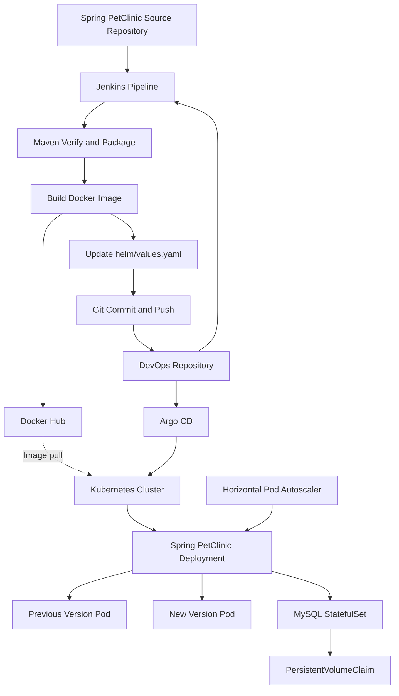

# Spring PetClinic — Cloud-Native DevOps Project

A cloud-native DevOps project that automates the build, packaging, container image delivery, and Kubernetes deployment lifecycle of Spring PetClinic.

The project integrates Jenkins CI/CD, Docker, Docker Hub, Helm, Kubernetes, GitHub, and Argo CD to demonstrate a GitOps workflow with automated synchronization, rolling updates, horizontal pod autoscaling, persistent database storage, and operational troubleshooting.

**Repository:** [spring-petclinic-DevOps](https://github.com/moamenothman/spring-petclinic-DevOps)

**Author:** Mo'men Othman

---

## Table of Contents

- [Project Overview](#project-overview)
- [Architecture](#architecture)
- [Technology Stack](#technology-stack)
- [Repository Structure](#repository-structure)
- [CI/CD Pipeline](#cicd-pipeline)
- [Docker Image Management](#docker-image-management)
- [Helm Configuration](#helm-configuration)
- [Argo CD and GitOps](#argo-cd-and-gitops)
- [Kubernetes Rolling Updates](#kubernetes-rolling-updates)
- [Kubernetes Deployment](#kubernetes-deployment)
- [Database and Persistent Storage](#database-and-persistent-storage)
- [Application Configuration and Secrets](#application-configuration-and-secrets)
- [Security and Resource Governance](#security-and-resource-governance)
- [Horizontal Pod Autoscaling](#horizontal-pod-autoscaling)
- [Self-Healing and Rollback](#self-healing-and-rollback)
- [Screenshots and Evidence](#screenshots-and-evidence)
- [Deployment and Verification](#deployment-and-verification)
- [Troubleshooting](#troubleshooting)
- [Future Improvements](#future-improvements)
- [Author](#author)

---

## Project Overview

Spring PetClinic is a Java-based Spring Boot application. This repository provides the DevOps infrastructure and automation used to build and deploy the application on Kubernetes.

The project separates application source code, CI execution, container image publishing, declarative configuration, and cluster reconciliation.

### Key Features

- Jenkins pipeline for Maven verification and packaging.
- Docker image build and publishing to Docker Hub.
- Versioned Docker image tags based on Jenkins build numbers.
- Automated updates to the image tag in Helm values.
- Git-based release tracking.
- Argo CD synchronization and self-healing.
- Helm-based Kubernetes resource management.
- Kubernetes Deployment with rolling update behavior.
- MySQL StatefulSet with persistent storage.
- Kubernetes Services, ConfigMaps, and Secrets.
- Horizontal Pod Autoscaler with observed scale-up and scale-down behavior.
- ResourceQuota and LimitRange for resource governance.
- NetworkPolicy and PodDisruptionBudget manifests.
- Troubleshooting documentation and screenshots of deployment operations.

### Project Goals

The primary goals are to demonstrate how to:

1. Automate application testing and packaging.
2. Build and publish container images.
3. connect CI output to version-controlled deployment configuration.
4. Use Git as the source of truth for the desired application image.
5. Reconcile Kubernetes resources through Argo CD.
6. Observe Kubernetes rolling updates during application releases.
7. Monitor scaling, readiness, and workload health.
8. Document technical failures, fixes, and verified outcomes.

---

## Architecture



### Architecture Flow

1. Jenkins checks out the DevOps repository and clones the application source.
2. Maven verifies and packages the application.
3. Docker builds the application image and publishes it to Docker Hub.
4. Jenkins updates `app.image.tag` in `helm/values.yaml`.
5. Jenkins commits and pushes the updated Helm configuration to GitHub.
6. Argo CD detects the changed desired state and synchronizes the configured Helm application.
7. Kubernetes reconciles the updated Deployment and performs the rolling update.
8. The new Pods are checked for readiness and the final workload state is verified.

Argo CD applies and reconciles the desired configuration. The Kubernetes Deployment controller manages the actual Pod rollout.

---

## Technology Stack

| Area | Technology |
|---|---|
| Application | Spring Boot, Java |
| Build and Verification | Maven |
| Containerization | Docker |
| CI/CD | Jenkins |
| Container Registry | Docker Hub |
| Source Control | Git, GitHub |
| Kubernetes Packaging | Helm |
| Orchestration | Kubernetes |
| Local Cluster | Minikube |
| GitOps | Argo CD |
| Database | MySQL |
| Persistent Storage | PersistentVolumeClaim |
| Configuration | ConfigMap |
| Secrets | Kubernetes Secret |
| Autoscaling | Horizontal Pod Autoscaler |
| Availability Controls | PodDisruptionBudget |
| Resource Governance | ResourceQuota, LimitRange |
| Networking | Kubernetes Services, NetworkPolicy |

---

## Repository Structure

```text
spring-petclinic-DevOps/
├── ArgoCD/
│   └── petclinic-application.yaml
├── Docker/
│   └── Dockerfile
├── Jenkins/
│   ├── Jenkinsfile
│   └── Jenkinsfile.before-helm
├── helm/
│   ├── Chart.yaml
│   ├── values.yaml
│   └── templates/
│       ├── app-configmap.yaml
│       ├── app-deployment.yaml
│       ├── app-hpa.yaml
│       ├── app-pdb.yaml
│       ├── app-service.yaml
│       ├── limit-range.yaml
│       ├── mysql-service.yaml
│       ├── mysql-statefulset.yaml
│       ├── namespace.yaml
│       ├── network-policy.yaml
│       └── resource-quota.yaml
├── k8s/
│   ├── app-configmap.yaml
│   ├── app-deployment.yaml
│   ├── app-hpa.yaml
│   ├── app-pdb.yaml
│   ├── app-service.yaml
│   ├── limit-range.yaml
│   ├── mysql-service.yaml
│   ├── mysql-statefulset.yaml
│   ├── namespace.yaml
│   ├── network-policy.yaml
│   └── resource-quota.yaml
├── backups/
│   ├── petclinic-20261020-031027.sql
│   └── petclinic-k8s-backup.yaml
├── screenshots/
├── tests/
│   └── hpa-load-generator.yaml
├── troubleshooting/
│   ├── README.md
│   └── screenshots/
└── README.md
```

**Important:** The current Argo CD application tracks the `helm/` chart. The `k8s/` directory contains Kubernetes manifests and may be used for direct-manifest workflows or reference, but changes to it do not automatically affect the current Argo CD source unless the Application configuration is changed.

Review backup files before publishing them. Database dumps and Kubernetes backups may contain sensitive data or configuration. Do not commit plaintext credentials or secret-bearing backups.

---

## CI/CD Pipeline

The pipeline is defined in [`Jenkins/Jenkinsfile`](Jenkins/Jenkinsfile).

### Pipeline Stages

| Stage | Responsibility |
|---|---|
| Checkout DevOps Repository | Retrieves the pipeline and deployment configuration. |
| Checkout Application | Clones the Spring PetClinic source repository. |
| Test and Package | Runs Maven verification and packages the application. |
| Prepare Docker Context | Copies the application artifact and Dockerfile into the build context. |
| Build Docker Image | Builds the application image with versioned and `latest` tags. |
| Push Docker Image | Authenticates to Docker Hub and publishes the image. |
| Update Deployment Image in Git | Updates the Helm image tag, commits the change, and pushes to GitHub. |

The pipeline runs Maven inside a container. The current Maven invocation uses Bash to execute the wrapper script, avoiding dependence on its executable permission.

A shell `trap` attempts to restore ownership of the Maven `target` directory to UID `105` and GID `108`, as configured for the Jenkins environment.

### Jenkins Credentials

The pipeline uses Jenkins Credentials rather than embedding registry or Git credentials in source code.

| Credential ID | Purpose |
|---|---|
| `dockerhub-credentials` | Authenticates to Docker Hub. |
| `github` | Authenticates when pushing the Helm values update to GitHub. |

The GitHub credential must have permission to write repository contents. Credentials should never be printed in build logs or committed to Git.

### Successful Pipeline Outcome

The latest pipeline run was reported as successful after resolving the Maven Wrapper execution issue.

The successful release workflow connects the build and image delivery stages with a Git commit updating Helm configuration. Argo CD then reconciles the updated desired state.

The successful Jenkins run is evidence that the pipeline completed its configured stages for that run. Each later release should still be verified independently.

---

## Docker Image Management

The pipeline publishes images to:

```text
moamenothman1/spring-petclinic
```

The versioned tag is based on the Jenkins build number:

```text
moamenothman1/spring-petclinic:<BUILD_NUMBER>
```

The pipeline also publishes:

```text
moamenothman1/spring-petclinic:latest
```

The versioned tag is used in Helm configuration to identify the intended release. This is preferable to relying on a mutable `latest` tag for deployment tracking.

The Docker build context is prepared from the packaged JAR and [`Docker/Dockerfile`](Docker/Dockerfile).

A successful image push confirms registry delivery, but the actual running version must be checked in Kubernetes.

---

## Helm Configuration

The current Helm chart is located in `helm/`.

The image configuration is maintained in `helm/values.yaml`, under `app.image`.

Example structure:

```yaml
namespace: petclinic

app:
  name: spring-petclinic
  replicaCount: 2
  image:
    repository: moamenothman1/spring-petclinic
    tag: "6"
    pullPolicy: IfNotPresent
```

The tag shown above is an example of the previously observed version, not a guarantee of the current release.

### Automated Values Update

After pushing the new image, Jenkins updates the image tag in `helm/values.yaml`.

The pipeline then commits and pushes the updated file to the `main` branch. The rest of the Helm values should remain unchanged.

This approach separates image delivery from deployment reconciliation:

- Jenkins builds and publishes the artifact.
- Git records the desired image version.
- Argo CD applies the desired Helm configuration.
- Kubernetes performs the rollout.

---

## Argo CD and GitOps

The Argo CD Application definition is stored in [`ArgoCD/petclinic-application.yaml`](ArgoCD/petclinic-application.yaml).

The current configuration uses the `main` branch and the `helm/` chart path, with the application deployed into the `petclinic` namespace.

### GitOps Configuration

| Setting | Current Configuration |
|---|---|
| Application | `petclinic` |
| Argo CD namespace | `argocd` |
| Git branch | `main` |
| Source path | `helm/` |
| Destination namespace | `petclinic` |
| Automated synchronization | Enabled |
| Self-healing | Enabled |
| Pruning | Enabled |

The actual configuration should be confirmed against the committed Application manifest when reproducing the project.

### What Happens After a Git Change?

When Jenkins pushes an updated image tag:

1. The desired Helm configuration changes in Git.
2. Argo CD detects the changed source revision.
3. The Application may show `OutOfSync` before reconciliation.
4. Argo CD synchronizes the Helm resources according to its configured policy.
5. Kubernetes receives the updated Deployment specification.
6. The Kubernetes Deployment controller performs the rollout.
7. Argo CD reports the resulting synchronization and health state.

Automated sync removes the need for a separate manual deployment command for each eligible Git change.

### Self-Healing and Pruning

With self-healing enabled, Argo CD can reconcile supported live-resource changes that differ from the desired state in Git.

With pruning enabled, Argo CD can remove resources it manages when their manifests are removed from its tracked source.

Pruning can be destructive. Persistent storage, database resources, credentials, and other important resources must be managed carefully. Review changes before removing resources from the Git-managed configuration.

### GitOps Verification Commands

Check the Argo CD Application:

```bash
kubectl get application petclinic -n argocd
```

Inspect its detailed conditions:

```bash
kubectl describe application petclinic -n argocd
```

Check the desired image tag in Helm values:

```bash
grep -A 5 '^app:' helm/values.yaml
```

Inspect the image configured on the Deployment:

```bash
kubectl get deployment spring-petclinic -n petclinic \
  -o jsonpath='{.spec.template.spec.containers[*].image}'

echo
```

The image reference in Git, the Deployment, and the running Pods should agree on the expected version.

---

## Kubernetes Rolling Updates

A key demonstrated behavior in this project is the rolling update that follows an image change.

When the Deployment's Pod template changes, Kubernetes manages the replacement of Pods according to the Deployment update strategy and availability settings.

### Observed Rollout Sequence

The captured screenshots show the following sequence:

1. Argo CD detected a change in the Git-managed image configuration.
2. The Application entered an `OutOfSync` state before synchronization.
3. Argo CD synchronized the updated Helm configuration.
4. A new Pod started while the previous Pod running image version `6` was still present.
5. The previous Pod remained temporarily during the replacement process.

This is consistent with a Kubernetes rolling update. The new Pod must satisfy the configured readiness and availability requirements before the rollout can progress as intended.

### Responsibility of Each Component

**Jenkins** builds and publishes the new image and commits the new image tag to Git.

**Argo CD** detects and reconciles the changed Git-managed desired state.

**Kubernetes Deployment controller** performs the actual rolling update and manages Pod replacement.

This separation is central to the GitOps workflow: Jenkins does not need to directly run `kubectl rollout` to initiate every release when Argo CD is managing the desired state.

### Verify Rollout Completion

```bash
kubectl rollout status deployment/spring-petclinic -n petclinic
```

Check the Deployment:

```bash
kubectl get deployment spring-petclinic -n petclinic
```

Inspect the Pods:

```bash
kubectl get pods -n petclinic \
  -o custom-columns='POD:.metadata.name,IMAGE:.spec.containers[*].image,READY:.status.containerStatuses[*].ready'
```

A rollout should be considered complete only after the intended new Pods are ready and the Deployment reports the expected availability.

The captured rollout screenshots demonstrate the observed transition. They do not independently prove zero-downtime availability; that requires an application availability test during the rollout.

---

## Kubernetes Deployment

The Helm chart defines the application and supporting Kubernetes resources through `helm/templates/`.

The repository also contains corresponding standalone manifests in `k8s/`.

### Application Deployment

The Spring PetClinic Deployment manages the application Pods. Its configuration includes the container image, replica settings, ports, health probes, resource requests and limits, and references to application configuration and database credentials.

The current desired replica count and other settings should be read from the active Helm values and rendered chart rather than assumed from older screenshots.

### Services

Kubernetes Services provide stable networking for the application and database.

The application Service provides access to Spring PetClinic through its configured Service port and exposure type.

The MySQL Service provides internal database discovery at:

```text
mysql:3306
```

Actual application reachability depends on the configured Service type and the cluster's networking.

### MySQL StatefulSet

MySQL runs as a StatefulSet with persistent storage. The StatefulSet provides stable workload identity and persistent-volume association for the database.

Database resources should not be deleted casually during application deployment or troubleshooting.

---

## Database and Persistent Storage

The project uses MySQL as a separate workload from the application.

The database StatefulSet is configured to use persistent storage through a PersistentVolumeClaim.

Previously observed storage configuration:

| Property | Value |
|---|---|
| Claim | `mysql-data-mysql-0` |
| Requested capacity | `2Gi` |
| Access mode | `ReadWriteOnce` |
| Observed status | `Bound` |

These values describe the previously observed configuration and should be verified against the current cluster.

Persistent storage helps retain database files when a database Pod is recreated. Data retention also depends on the storage provisioner and the PersistentVolume reclaim policy.

A backup file is present in the repository's `backups/` directory. The backup has not been established as restorable merely by its presence. A reliable recovery process requires a tested restore procedure.

---

## Application Configuration and Secrets

Application configuration is maintained separately from the application image.

The application ConfigMap configures the active Spring profile and database connection settings. The current configuration has used the `mysql` profile and a JDBC URL in this format:

```text
jdbc:mysql://mysql:3306/petclinic
```

The database credentials are provided through a Kubernetes Secret named `mysql-secret` in the `petclinic` namespace.

The expected keys are:

- `username`
- `password`
- `root-password`

The ordinary Kubernetes Secret is provisioned separately from the Git-managed chart. A fresh environment must create the required Secret securely before deploying workloads that depend on it.

Do not commit plaintext database credentials, GitHub tokens, Docker Hub passwords, or sensitive database backups.

For production use, a dedicated secrets-management solution should handle provisioning, access control, rotation, and recovery.

---

## Security and Resource Governance

### NetworkPolicy

The project includes a NetworkPolicy intended to restrict ingress to MySQL Pods.

The policy selects the database Pods and permits TCP traffic on port `3306` from the application Pods selected by its labels.

Effective enforcement depends on the cluster networking implementation supporting NetworkPolicy. The presence of a policy manifest alone does not prove that unauthorized traffic is blocked.

### ResourceQuota and LimitRange

The chart includes a ResourceQuota and LimitRange to govern resource consumption in the `petclinic` namespace.

ResourceQuota can limit aggregate CPU and memory requests and limits, the number of Pods and Services, PersistentVolumeClaims, and requested storage.

LimitRange can define container resource defaults, minimums, and maximums.

These settings must be compatible with the expected number of application replicas and the database workload. An insufficient quota can prevent a rolling update or autoscaling operation from creating additional Pods.

### PodDisruptionBudget

The project includes a PodDisruptionBudget for application availability during supported voluntary disruptions.

A PDB does not prevent every disruption and does not guarantee availability during unexpected infrastructure failures.

### Production Security Considerations

- Store registry and source-control credentials in Jenkins Credentials.
- Keep database credentials outside version-controlled plaintext manifests.
- Review backup contents before publishing the repository.
- Restrict access to Kubernetes Secrets using RBAC.
- Confirm NetworkPolicy enforcement in the target cluster.
- Use image vulnerability scanning and dependency checks before production deployment.

---

## Horizontal Pod Autoscaling

The project includes a Horizontal Pod Autoscaler configured for the application Deployment.

Previously documented HPA settings:

| Setting | Value |
|---|---|
| Target Deployment | `spring-petclinic` |
| Metric | CPU utilization |
| Target utilization | 70% of requested CPU |
| Minimum replicas | 2 |
| Maximum replicas | 4 |

Verify the current settings in `helm/values.yaml` and the rendered chart before reproducing the test.

### Load Test

The load generator is defined in [`tests/hpa-load-generator.yaml`](tests/hpa-load-generator.yaml).

Previously captured observations showed the application scaling from two replicas to four under generated HTTP load and subsequently scaling down after the load generator was stopped.

The recorded CPU utilization was measured relative to CPU requests, not as a percentage of total host CPU utilization.

These observations demonstrate HPA behavior in the local Minikube environment under the tested workload. They are not a production performance benchmark and do not establish maximum throughput or supported user capacity.

### Monitor Autoscaling

```bash
kubectl get hpa -n petclinic
kubectl describe hpa spring-petclinic -n petclinic
kubectl top pods -n petclinic
kubectl get pods -n petclinic --watch
```

Run the load generator:

```bash
kubectl apply -f tests/hpa-load-generator.yaml
```

After the test, stop the load generator:

```bash
kubectl delete -f tests/hpa-load-generator.yaml
```

Observe the HPA and Pod count to verify scale-up and scale-down behavior.

---

## Self-Healing and Rollback

### Self-Healing

Kubernetes controllers maintain the desired workload state and can replace failed or deleted application Pods.

Argo CD self-healing reconciles supported live-resource drift against the Git-managed desired state.

These are related but distinct behaviors: Kubernetes maintains workload replicas, while Argo CD reconciles the cluster against the declared configuration in Git.

Evidence of the captured self-healing scenario is available in [`screenshots/self-healing-watch.png`](screenshots/self-healing-watch.png).

### Rollback

The repository includes a rollback screenshot at [`screenshots/rollback.png`](screenshots/rollback.png).

A rollback must be interpreted in the context of the operation that was captured. A direct Kubernetes rollback and a GitOps rollback are not identical.

For the GitOps workflow, the preferred controlled approach is to restore the previous known-good image tag in the Git-managed Helm values and allow Argo CD to reconcile that desired state. This keeps Git consistent with the intended running version.

A rollback is complete only after the previous image is running, the Pods are ready, and the Argo CD Application has reached the expected synchronization and health states.

---

## Screenshots and Evidence

The `screenshots/` directory contains evidence captured during pipeline execution and Kubernetes operations.

### Jenkins Build and Image Delivery

**Initial pipeline build and Docker image creation**


**Initial pipeline stages**


**Docker image publishing**


**Pipeline stages including the deployment configuration update**


### GitOps Image Update

**Jenkins commit updating deployment configuration**


**Argo CD detects a change in the image configuration**


**Argo CD synchronization and rolling update in progress**


**Argo CD synchronized and healthy**


**Application synchronized after a new build**


### Kubernetes Operations

**Rolling update**


**Rollback**


**Self-healing**


### Autoscaling

**HPA metrics**


**Pod scaling**


**Scale-down**


Screenshots document the state visible at capture time. Current release status should always be verified from Jenkins, Git, Argo CD, and Kubernetes.

---

## Deployment and Verification

### Prerequisites

- Git
- Docker
- `kubectl`
- Minikube or another Kubernetes cluster
- Jenkins with Docker access and the required credentials
- Argo CD
- Helm support in the deployment environment
- A suitable StorageClass for MySQL persistent storage
- Secure provisioning of the `mysql-secret` Secret

### 1. Clone the Repository

```bash
git clone https://github.com/moamenothman/spring-petclinic-DevOps.git
cd spring-petclinic-DevOps
```

### 2. Check the Kubernetes Context

```bash
kubectl config current-context
kubectl get nodes
```

Confirm that the commands target the intended development cluster.

### 3. Inspect the Helm Configuration

```bash
cat helm/values.yaml
cat ArgoCD/petclinic-application.yaml
```

Review the image repository, image tag, namespace, and Argo CD source path before applying changes.

### 4. Check the Argo CD Application

```bash
kubectl get application petclinic -n argocd
kubectl describe application petclinic -n argocd
```

Confirm the source repository, branch, Helm path, destination namespace, sync policy, and health status.

### 5. Verify the Deployment

```bash
kubectl get deployment spring-petclinic -n petclinic
kubectl rollout status deployment/spring-petclinic -n petclinic
kubectl get pods -n petclinic
```

### 6. Verify the Running Image

```bash
kubectl get deployment spring-petclinic -n petclinic \
  -o jsonpath='{.spec.template.spec.containers[*].image}'

echo
```

List the Pod images and readiness:

```bash
kubectl get pods -n petclinic \
  -o custom-columns='POD:.metadata.name,IMAGE:.spec.containers[*].image,READY:.status.containerStatuses[*].ready'
```

### 7. Verify Database and Storage Resources

```bash
kubectl get statefulset,service,pvc -n petclinic
kubectl get pods -n petclinic
```

Do not delete database PVCs or persistent volumes as part of routine application rollout testing.

### 8. Verify Autoscaling and Resource Controls

```bash
kubectl get hpa,pdb,resourcequota,limitrange -n petclinic
kubectl top pods -n petclinic
```

Metrics availability and namespace quota can affect scaling and rolling update behavior.

### 9. Validate a New Release

For a new Jenkins build:

1. Confirm the Maven verification and packaging stage succeeds.
2. Confirm Docker image build and push succeed.
3. Confirm Jenkins commits the expected tag to `helm/values.yaml`.
4. Confirm Argo CD detects and reconciles the change.
5. Confirm the Deployment rolls out the expected image.
6. Confirm the new Pods are ready.
7. Confirm the Argo CD Application reaches the expected synchronized and healthy state.

A successful Jenkins build alone does not prove that the new version is running in Kubernetes.

---

## Troubleshooting

The troubleshooting log and related screenshots are maintained in [`troubleshooting/README.md`](troubleshooting/README.md).

Each issue should document:

- Symptoms and relevant logs.
- Root cause, when established.
- Fixes attempted.
- Validation steps.
- Final observed outcome.
- Evidence screenshots.

### Jenkins Workspace Permissions

The Maven build runs inside a container with the application source bind-mounted from the Jenkins workspace.

Build artifacts created with root ownership can cause permission problems in later pipeline stages. The current pipeline uses a shell trap to attempt to restore ownership of the Maven `target` directory to the Jenkins user and group.

The pipeline's successful run after the Maven Wrapper invocation change provides evidence that the tested run completed. Subsequent builds should still be checked for workspace cleanup and checkout behavior.

### GitOps Manifest Update Failures

If the Helm values update or Git push fails:

1. Confirm that `helm/values.yaml` exists in the checked-out DevOps repository.
2. Verify that `app.image.tag` was updated to the expected Jenkins build number.
3. Check the Git diff and commit output.
4. Confirm that the Jenkins GitHub credential has repository write permission.
5. Inspect the push error and remote branch state.
6. Verify that the Argo CD Application tracks `helm/` on the intended branch.

Do not use force-push as a routine fix for branch divergence.

### Argo CD Sync or Health Problems

If the Git configuration changes but the Application does not reach the expected state, inspect:

- Repository, branch, and chart path.
- Application synchronization policy.
- Application conditions and Kubernetes events.
- Helm rendering and resource configuration.
- Image pull errors and container logs.
- Database credentials and persistent-volume status.
- Namespace quotas and available cluster capacity.

A `Synced` state does not necessarily mean that the workload is healthy. Check both synchronization and health.

### Rolling Update Problems

If the old Pod remains after a new image is committed:

```bash
kubectl rollout status deployment/spring-petclinic -n petclinic
kubectl describe deployment spring-petclinic -n petclinic
kubectl get pods -n petclinic
kubectl get events -n petclinic --sort-by=.lastTimestamp
```

Inspect readiness probe failures, image pull errors, resource constraints, and Deployment rollout conditions before deleting Pods manually.

---

## Future Improvements

Potential enhancements include:

- Automated build triggers with safe filtering.
- Multi-environment release promotion.
- Secure secret lifecycle management.
- Prometheus and Grafana dashboards.
- Centralized application and infrastructure logging.
- Container image vulnerability scanning.
- Dependency and software composition analysis.
- Additional NetworkPolicy restrictions after validating traffic flows.
- Database backup and restore testing.
- Cloud deployment to a managed Kubernetes service.
- Automated verification that the deployed image matches the Git-managed tag.
- A documented and repeatable GitOps rollback procedure.

These are potential improvements, not claims that all of them are already implemented.

---

## Author

**Mo'men Othman**

- GitHub: [moamenothman](https://github.com/moamenothman)
- Project repository: [spring-petclinic-DevOps](https://github.com/moamenothman/spring-petclinic-DevOps)

