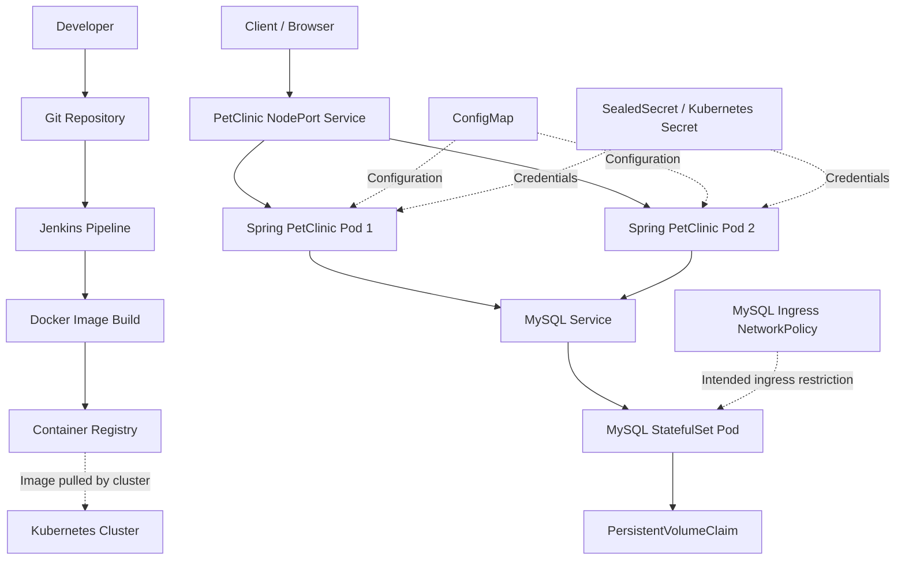

# Spring PetClinic — Cloud-Native DevOps Project

A containerized Spring Boot application deployed on Kubernetes, with Jenkins-based CI/CD, persistent MySQL storage, declarative infrastructure, and Kubernetes security configuration.

This project demonstrates practical DevOps workflows for building, packaging, deploying, and operating a Java application using Docker, Jenkins, and Kubernetes.

**Repository:** [spring-petclinic-DevOps](https://github.com/moamenothman/spring-petclinic-DevOps)

## Table of Contents

- [Project Overview](#project-overview)
- [Architecture](#architecture)
- [Technology Stack](#technology-stack)
- [Repository Structure](#repository-structure)
- [CI/CD Pipeline](#cicd-pipeline)
- [Docker](#docker)
- [Kubernetes Deployment](#kubernetes-deployment)
- [Application Configuration](#application-configuration)
- [Database and Persistent Storage](#database-and-persistent-storage)
- [Security](#security)
- [Pipeline Evidence](#pipeline-evidence)
- [Deployment and Verification](#deployment-and-verification)
- [Troubleshooting](#troubleshooting)
- [Future Improvements](#future-improvements)

## Project Overview

Spring PetClinic is a Java-based web application built with Spring Boot. This repository focuses on automating its container build and deployment lifecycle and running it on Kubernetes.

The application and database run as separate Kubernetes workloads. Kubernetes Services provide application access and internal database discovery, while configuration and credential resources keep connection settings separate from application code.

### Key Features

- Dockerized Spring Boot application.
- Jenkins pipeline for application build and delivery.
- Docker image build and registry publishing.
- Kubernetes Deployment with two application replicas.
- MySQL StatefulSet with persistent storage.
- Kubernetes Services for application access and database connectivity.
- ConfigMap-based application configuration.
- Sealed Secrets integration for encrypted secret manifests.
- CPU and memory requests and limits for application containers.
- Startup, readiness, and liveness probes.
- NetworkPolicy manifest for restricting database ingress.
- Kubernetes rollout, rollback, and self-healing demonstrations.

## Architecture



The diagram represents the intended architecture. Exact Jenkins triggers, registry configuration, and enforcement of network restrictions depend on the deployed configuration.

## Technology Stack

| Area | Technology |
|---|---|
| Application | Spring Boot, Java |
| Database | MySQL 8.4 |
| Containerization | Docker |
| CI/CD | Jenkins |
| Orchestration | Kubernetes |
| Local Cluster | Minikube |
| Application Workload | Deployment |
| Database Workload | StatefulSet |
| Networking | Kubernetes Services, NetworkPolicy |
| Configuration | ConfigMap |
| Secret Management | Kubernetes Secret, Sealed Secrets |
| Persistent Storage | PersistentVolumeClaim |
| Version Control | Git, GitHub |

## Repository Structure

```text
spring-petclinic-DevOps/
├── Docker/
│   └── Dockerfile
├── Jenkins/
│   └── Jenkinsfile
├── k8s/
│   ├── app-configmap.yaml
│   ├── app-deployment.yaml
│   ├── app-service.yaml
│   ├── mysql-secret.yaml
│   ├── mysql-service.yaml
│   ├── mysql-statefulset.yaml
│   ├── namespace.yaml
│   └── network-policy.yaml
├── screenshots/
│   ├── 1st-pipeline-buid-test-and-build-docker-image.png
│   ├── 1st-pipeline-stages.png
│   ├── pipeline-stages-push-docker-image.png
│   ├── rollback.png
│   ├── rollout.png
│   └── self-healing-watch.png
├── troubleshooting/
│   ├── README.md
│   └── screenshots/
└── README.md
```

## CI/CD Pipeline

The Jenkins pipeline is defined in [`Jenkins/Jenkinsfile`](Jenkins/Jenkinsfile).

The workflow covers application build and testing, Docker image creation, and image publishing as represented by the pipeline evidence in this repository.

### Pipeline Workflow

1. Retrieve the application source.
2. Build the Java application and execute the configured tests.
3. Build a Docker image using the project Dockerfile.
4. Publish the image to the configured container registry.

The exact stages, credentials configuration, image tags, and triggers are defined by the Jenkinsfile and Jenkins environment.

Registry credentials should be stored in Jenkins credentials management, not hardcoded in source files.

## Docker

The application image is defined in [`Docker/Dockerfile`](Docker/Dockerfile).

Docker provides a consistent packaging format for running the application across development and deployment environments.

The Kubernetes Deployment uses the image:

```text
moamenothman1/spring-petclinic:6
```

This tag identifies the application image configured in the current Deployment. Future releases should use an intentional tagging strategy so that deployed versions can be identified and rolled back reliably.

## Kubernetes Deployment

Kubernetes manifests are stored in the `k8s/` directory.

### Namespace

[`k8s/namespace.yaml`](k8s/namespace.yaml) defines the namespace used to group the application's Kubernetes resources.

Current namespace:

```text
petclinic
```

### Application Deployment

[`k8s/app-deployment.yaml`](k8s/app-deployment.yaml) defines the Spring PetClinic Deployment.

The current workload configuration includes:

- Two application replicas.
- Container port `8080`.
- CPU and memory requests and limits.
- Startup, readiness, and liveness probes.
- Environment configuration from a ConfigMap.
- Database credentials from a Kubernetes Secret.

The Deployment provides declarative replica management and supports controlled rollouts when the application image or Pod template changes.

### Application Service

[`k8s/app-service.yaml`](k8s/app-service.yaml) exposes the application through a Kubernetes Service.

The current Service uses port `8080` and NodePort `30080`, enabling access through the configured Kubernetes node networking.

### Database Service

[`k8s/mysql-service.yaml`](k8s/mysql-service.yaml) defines the internal Service used by the application to reach MySQL.

The database connection uses the Kubernetes DNS name `mysql` on TCP port `3306`.

### MySQL StatefulSet

[`k8s/mysql-statefulset.yaml`](k8s/mysql-statefulset.yaml) defines the MySQL database workload.

A StatefulSet is appropriate for workloads that need stable identity and persistent storage configuration.

## Application Configuration

Application configuration is defined in [`k8s/app-configmap.yaml`](k8s/app-configmap.yaml).

The current configuration uses the `mysql` Spring profile and a JDBC URL following this format:

```text
jdbc:mysql://mysql:3306/petclinic
```

The database name, Service name, port, and active Spring profile must remain consistent with the database and application configuration.

The ConfigMap keeps non-sensitive settings outside the application image, making it easier to adjust deployment configuration independently of the build process.

## Database and Persistent Storage

MySQL uses a PersistentVolumeClaim associated with the StatefulSet.

The current database claim has the following configuration:

| Property | Value |
|---|---|
| Claim | `mysql-data-mysql-0` |
| Requested capacity | `2Gi` |
| Access mode | `ReadWriteOnce` |
| Observed status | `Bound` |

Persistent storage helps retain database files when the database Pod is recreated. Actual data retention also depends on the storage provisioner and the PersistentVolume reclaim policy.

Persistent volumes are not a replacement for tested database backups.

## Security

### Secret Management

The repository includes an encrypted SealedSecret manifest:

[`k8s/mysql-secret.yaml`](k8s/mysql-secret.yaml)

The Sealed Secrets controller can decrypt this manifest into a Kubernetes Secret in the intended cluster and namespace.

Sensitive values should not be committed as plaintext. The controller's private sealing key must be backed up securely outside source control.

Local Kubernetes backups may contain credentials or other sensitive information and must be excluded from Git.

### NetworkPolicy

[`k8s/network-policy.yaml`](k8s/network-policy.yaml) defines an ingress policy for MySQL Pods.

The policy selects Pods labelled `app=mysql` and permits inbound TCP traffic on port `3306` from Pods labelled `app=spring-petclinic`.

The policy does not define application ingress or egress restrictions.

Effective enforcement depends on the cluster's CNI implementation. The existence of a NetworkPolicy resource alone does not guarantee that traffic is filtered; the cluster networking configuration must support enforcement.

### Resource Management and Health Checks

The application Deployment specifies resource requests and limits to make workload resource requirements explicit.

Startup, readiness, and liveness probes help Kubernetes manage application startup, determine readiness to receive traffic, and detect container health failures.

## Pipeline Evidence

The `screenshots/` directory contains evidence of pipeline execution and Kubernetes operations.

### Build and Image Delivery

**Initial pipeline build and Docker image creation**


**Pipeline stages**


**Pipeline stages and Docker image publishing**


### Kubernetes Operations

**Deployment rollout**


**Rollback demonstration**


**Self-healing demonstration**


These screenshots provide supporting evidence of the activities captured during the project. Current workload status should be checked directly in the target cluster.

## Deployment and Verification

### Prerequisites

Install and configure:

- Docker
- kubectl
- Minikube or another Kubernetes cluster
- Git
- Jenkins and the required build tools, if running the pipeline

Ensure the cluster has sufficient resources and a working StorageClass for the MySQL persistent volume.

### 1. Clone the Repository

```bash
git clone https://github.com/moamenothman/spring-petclinic-DevOps.git
cd spring-petclinic-DevOps
```

### 2. Check the Kubernetes Context

```bash
kubectl config current-context
kubectl get nodes
```

Confirm that the commands target the intended development cluster.

### 3. Create the Namespace

```bash
kubectl apply -f k8s/namespace.yaml
```

### 4. Apply Application Configuration

```bash
kubectl apply -f k8s/app-configmap.yaml
```

### 5. Apply the Database Secret

```bash
kubectl apply -f k8s/mysql-secret.yaml
```

The Sealed Secrets controller must be installed and available in the cluster. The encrypted manifest must target the correct namespace and Secret name.

### 6. Deploy MySQL

```bash
kubectl apply -f k8s/mysql-service.yaml
kubectl apply -f k8s/mysql-statefulset.yaml
```

### 7. Deploy the Application

```bash
kubectl apply -f k8s/app-service.yaml
kubectl apply -f k8s/app-deployment.yaml
```

### 8. Apply the NetworkPolicy

```bash
kubectl apply -f k8s/network-policy.yaml
```

### 9. Verify the Workloads

```bash
kubectl get pods -n petclinic
kubectl get services -n petclinic
kubectl get pvc -n petclinic
kubectl get networkpolicy -n petclinic
```

Inspect rollout status and application logs:

```bash
kubectl rollout status deployment/spring-petclinic -n petclinic
kubectl rollout status statefulset/mysql -n petclinic
kubectl logs deployment/spring-petclinic -n petclinic --tail=80
```

To verify NetworkPolicy behavior, test permitted application-to-database traffic and an unauthorized connection attempt. Confirm that the CNI enforces NetworkPolicy rules before treating the restriction as a validated security control.

## Troubleshooting

Troubleshooting notes and related evidence are maintained in [`troubleshooting/README.md`](troubleshooting/README.md).

The troubleshooting record should capture:

- Symptoms and relevant error messages.
- Root cause, when established.
- Fixes attempted.
- Validation steps and observed results.
- Screenshots or logs supporting the final outcome.

Only verified results should be marked as resolved.

## Future Improvements

Potential future enhancements include:

- Automated deployment triggered by successful image publishing.
- Versioned and reproducible release tags.
- Helm charts for reusable Kubernetes packaging.
- GitOps-based deployment management with Argo CD.
- Metrics and dashboards with Prometheus and Grafana.
- Centralized log collection.
- Additional NetworkPolicy rules after mapping required traffic flows.
- Database backup and restore validation.
- Deployment security scanning and image vulnerability assessment.
- Cloud deployment using a managed Kubernetes service.

These are potential extensions, not claims that the corresponding features are already implemented.

## Author

**Mo'men Othman**

- GitHub: [moamenothman](https://github.com/moamenothman)
- Project: [spring-petclinic-DevOps](https://github.com/moamenothman/spring-petclinic-DevOps)

