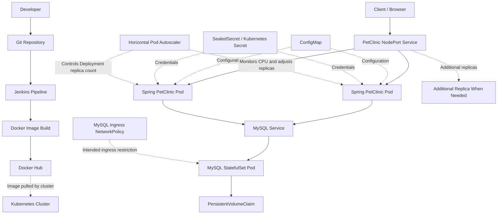

# Spring PetClinic — Cloud-Native DevOps Project

A containerized Spring Boot application deployed on Kubernetes, with Jenkins-based CI/CD, persistent MySQL storage, declarative infrastructure, and Kubernetes security configuration.

This project demonstrates practical DevOps workflows for building, packaging, deploying, and operating a Java application using Docker, Jenkins, and Kubernetes.

**Repository:** [spring-petclinic-DevOps](https://github.com/moamenothman/spring-petclinic-DevOps)

## Table of Contents

- [Project Overview](#project-overview)
- [Architecture](#architecture)
- [Technology Stack](#technology-stack)
- [Repository Structure](#repository-structure)
- [CI/CD Pipeline](#cicd-pipeline)
- [Docker](#docker)
- [Kubernetes Deployment](#kubernetes-deployment)
- [Application Configuration](#application-configuration)
- [Database and Persistent Storage](#database-and-persistent-storage)
- [Security](#security)
- [Reliability and Resource Management](#reliability-and-resource-management)
- [Horizontal Pod Autoscaling](#horizontal-pod-autoscaling)
- [Pipeline Evidence](#pipeline-evidence)
- [Deployment and Verification](#deployment-and-verification)
- [Troubleshooting](#troubleshooting)
- [Future Improvements](#future-improvements)

## Project Overview

Spring PetClinic is a Java-based web application built with Spring Boot. This repository focuses on automating its container build and deployment lifecycle and running it on Kubernetes.

The application and database run as separate Kubernetes workloads. Kubernetes Services provide application access and internal database discovery, while configuration and credential resources keep connection settings separate from application code.

### Key Features

- Dockerized Spring Boot application.
- Jenkins pipeline for application build and delivery.
- Docker image build and registry publishing.
- Kubernetes Deployment with a minimum of two application replicas.
- MySQL StatefulSet with persistent storage.
- Kubernetes Services for application access and database connectivity.
- ConfigMap-based application configuration.
- Sealed Secrets integration for encrypted secret manifests.
- CPU and memory requests and limits.
- Startup, readiness, and liveness probes.
- NetworkPolicy manifest for intended database ingress restrictions.
- PodDisruptionBudget for voluntary disruption protection.
- ResourceQuota and LimitRange for namespace resource governance.
- Horizontal Pod Autoscaler with verified scale-up and scale-down behavior.
- Kubernetes rollout, rollback, and self-healing demonstrations.

## Architecture



The diagram represents the intended architecture. The HPA manages the application Deployment's replica count within its configured range. The database runs independently using a StatefulSet and persistent storage.

Exact Jenkins triggers, registry configuration, and enforcement of network restrictions depend on the deployed configuration.

## Technology Stack

| Area | Technology |
|---|---|
| Application | Spring Boot, Java |
| Database | MySQL 8.4 |
| Containerization | Docker |
| CI/CD | Jenkins |
| Container Registry | Docker Hub |
| Orchestration | Kubernetes |
| Local Cluster | Minikube |
| Application Workload | Deployment |
| Database Workload | StatefulSet |
| Networking | Kubernetes Services, NetworkPolicy |
| Configuration | ConfigMap |
| Secret Management | Kubernetes Secret, Sealed Secrets |
| Persistent Storage | PersistentVolumeClaim |
| Autoscaling | Horizontal Pod Autoscaler |
| Availability Controls | PodDisruptionBudget |
| Resource Governance | ResourceQuota, LimitRange |
| Version Control | Git, GitHub |

## Repository Structure

```text
spring-petclinic-DevOps/
├── Docker/
│   └── Dockerfile
├── Jenkins/
│   └── Jenkinsfile
├── README.md
├── backups/
│   └── petclinic-k8s-backup.yaml
├── k8s/
│   ├── app-configmap.yaml
│   ├── app-deployment.yaml
│   ├── app-hpa.yaml
│   ├── app-pdb.yaml
│   ├── app-service.yaml
│   ├── limit-range.yaml
│   ├── mysql-secret.yaml
│   ├── mysql-service.yaml
│   ├── mysql-statefulset.yaml
│   ├── namespace.yaml
│   ├── network-policy.yaml
│   └── resource-quota.yaml
├── screenshots/
│   ├── 1st-pipeline-buid-test-and-build-docker-image.png
│   ├── 1st-pipeline-stages.png
│   ├── auto-scaling-hpa-watch.png
│   ├── auto-scaling-pods-watch.png
│   ├── pipeline-stages-push-docker-image.png
│   ├── rollback.png
│   ├── rollout.png
│   ├── scaledown.png
│   └── self-healing-watch.png
├── tests/
│   └── hpa-load-generator.yaml
└── troubleshooting/
    ├── README.md
    └── screenshots/
```

**Security note:** The `backups/` directory is intended for local recovery. Ensure backup files are excluded from Git if they contain credentials, encrypted material that should remain private, or other sensitive configuration.

## CI/CD Pipeline

The Jenkins pipeline is defined in [`Jenkins/Jenkinsfile`](Jenkins/Jenkinsfile).

The workflow covers application build and testing, Docker image creation, and image publishing as represented by the pipeline evidence in this repository.

### Pipeline Workflow

1. Retrieve the application source.
2. Build the Java application and execute the configured tests.
3. Build a Docker image using the project Dockerfile.
4. Publish the image to the configured container registry.

The exact stages, credentials configuration, image tags, and triggers are defined by the Jenkinsfile and Jenkins environment.

Registry credentials should be stored in Jenkins Credentials, not hardcoded in source files.

## Docker

The application image is defined in [`Docker/Dockerfile`](Docker/Dockerfile).

Docker provides a consistent packaging format for running the application across development and deployment environments.

The Kubernetes Deployment uses the image:

```text
moamenothman1/spring-petclinic:6
```

This tag identifies the application image configured in the current Deployment. Future releases should use an intentional tagging strategy so that deployed versions can be identified and rolled back reliably.

## Kubernetes Deployment

Kubernetes manifests are stored in the `k8s/` directory.

### Namespace

[`k8s/namespace.yaml`](k8s/namespace.yaml) defines the namespace used to group the application's Kubernetes resources.

Current namespace:

```text
petclinic
```

### Application Deployment

[`k8s/app-deployment.yaml`](k8s/app-deployment.yaml) defines the Spring PetClinic Deployment.

The current workload configuration includes:

- Two initial application replicas, managed by the HPA.
- Container port `8080`.
- CPU and memory requests and limits.
- Startup, readiness, and liveness probes.
- Environment configuration from a ConfigMap.
- Database credentials from a Kubernetes Secret.

The Deployment provides declarative replica management and supports controlled rollouts when the application image or Pod template changes.

### Application Service

[`k8s/app-service.yaml`](k8s/app-service.yaml) exposes the application through a Kubernetes Service.

The current Service uses port `8080` and NodePort `30080`, enabling access through the configured Kubernetes node networking.

### Database Service

[`k8s/mysql-service.yaml`](k8s/mysql-service.yaml) defines the internal Service used by the application to reach MySQL.

The database connection uses the Kubernetes DNS name `mysql` on TCP port `3306`.

### MySQL StatefulSet

[`k8s/mysql-statefulset.yaml`](k8s/mysql-statefulset.yaml) defines the MySQL database workload.

A StatefulSet is appropriate for workloads that need stable identity and persistent storage configuration.

## Application Configuration

Application configuration is defined in [`k8s/app-configmap.yaml`](k8s/app-configmap.yaml).

The current configuration uses the `mysql` Spring profile and a JDBC URL following this format:

```text
jdbc:mysql://mysql:3306/petclinic
```

The database name, Service name, port, and active Spring profile must remain consistent with the database and application configuration.

The ConfigMap keeps non-sensitive settings outside the application image, making it easier to adjust deployment configuration independently of the build process.

## Database and Persistent Storage

MySQL uses a PersistentVolumeClaim associated with the StatefulSet.

The current database claim has the following configuration:

| Property | Value |
|---|---|
| Claim | `mysql-data-mysql-0` |
| Requested capacity | `2Gi` |
| Access mode | `ReadWriteOnce` |
| Observed status | `Bound` |

Persistent storage helps retain database files when the database Pod is recreated. Actual data retention also depends on the storage provisioner and the PersistentVolume reclaim policy.

Persistent volumes are not a replacement for tested database backups.

## Security

### Secret Management

The repository includes an encrypted SealedSecret manifest:

[`k8s/mysql-secret.yaml`](k8s/mysql-secret.yaml)

The Sealed Secrets controller can decrypt this manifest into a Kubernetes Secret in the intended cluster and namespace.

Sensitive values should not be committed as plaintext. The controller's private sealing key must be backed up securely outside source control.

Local Kubernetes backups may contain credentials or other sensitive information and must be excluded from Git.

### NetworkPolicy

[`k8s/network-policy.yaml`](k8s/network-policy.yaml) defines an ingress policy for MySQL Pods.

The policy selects Pods labelled `app=mysql` and permits inbound TCP traffic on port `3306` from Pods labelled `app=spring-petclinic`.

The policy does not define application ingress or egress restrictions.

Effective enforcement depends on the cluster's CNI implementation. The existence of a NetworkPolicy resource alone does not guarantee that traffic is filtered; the cluster networking configuration must support enforcement.

## Reliability and Resource Management

### Health Probes

The application Deployment defines startup, readiness, and liveness probes.

- **Startup probe:** Allows the application time to start.
- **Readiness probe:** Controls whether the Pod is considered ready to receive traffic.
- **Liveness probe:** Helps detect a container that is no longer functioning correctly.

These probes help Kubernetes manage application availability and container recovery, but they do not guarantee that every application failure will be detected.

### Self-Healing

The Deployment controller maintains the desired number of application replicas and replaces Pods when necessary.

Evidence from the implementation is available in [`screenshots/self-healing-watch.png`](screenshots/self-healing-watch.png).

This demonstrates the captured self-healing scenario; it does not by itself prove resilience to every node or infrastructure failure.

### PodDisruptionBudget

[`k8s/app-pdb.yaml`](k8s/app-pdb.yaml) defines a PodDisruptionBudget with:

```yaml
spec:
  minAvailable: 1
```

The PDB helps limit certain voluntary disruptions from reducing the number of available application Pods below the configured threshold.

It does not prevent every disruption and does not guarantee availability during unexpected node failures.

### ResourceQuota

[`k8s/resource-quota.yaml`](k8s/resource-quota.yaml) defines namespace-level limits for:

- Aggregate CPU requests and limits.
- Aggregate memory requests and limits.
- Number of Pods.
- Number of Services.
- Number of PersistentVolumeClaims.
- Total requested persistent storage.

The updated quota was validated using a Kubernetes server-side dry run and then applied successfully.

The quota must be sized to accommodate the configured application replicas, database workload, and other Pods in the namespace.

### LimitRange

[`k8s/limit-range.yaml`](k8s/limit-range.yaml) defines minimum and maximum container resources along with default requests and limits.

These defaults apply to new containers that omit explicit resource settings. They do not replace resource values already specified in a Pod or Deployment manifest.

## Horizontal Pod Autoscaling

The Horizontal Pod Autoscaler is configured in [`k8s/app-hpa.yaml`](k8s/app-hpa.yaml).

### Configuration

| Setting | Value |
|---|---|
| Target Deployment | `spring-petclinic` |
| Metric | CPU utilization |
| Target utilization | 70% of requested CPU |
| Minimum replicas | 2 |
| Maximum replicas | 4 |

The HPA uses CPU metrics to adjust the Deployment's replica count. It depends on a working metrics pipeline and sufficient namespace quota and cluster capacity.

### Load Test

A temporary load-generator Pod defined in [`tests/hpa-load-generator.yaml`](tests/hpa-load-generator.yaml) sent repeated HTTP requests to the application Service.

The HPA watch captured the following progression:

| Observed CPU utilization | Replica count | Observation |
|---:|---:|---|
| 2% | 2 | Baseline before load |
| 94% | 2 → 3 | Scale-up began |
| 150% | 3 → 4 | Further scale-up |
| 84%–100% | 4 | Maximum replica count reached |

After the load generator was stopped, the application scaled down again.

**Verified outcome:** The local Minikube environment successfully scaled the application from two replicas to four under generated HTTP load and subsequently scaled down after the load was removed.

The CPU utilization values are measured relative to the containers' CPU requests, not the total CPU utilization of the host machine.

This test demonstrates HPA behavior under the specific local workload. It is not a production performance benchmark and does not establish maximum throughput, latency, or user capacity.

### Autoscaling Evidence

**HPA metrics and replica changes**


**Pod count during autoscaling**


**Scale-down after load removal**


## Pipeline Evidence

The `screenshots/` directory contains evidence of pipeline execution and Kubernetes operations.

### Build and Image Delivery

**Initial pipeline build and Docker image creation**


**Pipeline stages**


**Pipeline stages and Docker image publishing**


### Kubernetes Operations

**Deployment rollout**


**Rollback demonstration**


**Self-healing demonstration**


These screenshots provide supporting evidence of the activities captured during the project. Current workload status should be checked directly in the target cluster.

## Deployment and Verification

### Prerequisites

Install and configure:

- Docker
- `kubectl`
- Minikube or another Kubernetes cluster
- Git
- Jenkins and the required build tools, if running the pipeline

Ensure the cluster has sufficient resources and a working StorageClass for the MySQL persistent volume.

### 1. Clone the Repository

```bash
git clone https://github.com/moamenothman/spring-petclinic-DevOps.git
cd spring-petclinic-DevOps
```

### 2. Check the Kubernetes Context

```bash
kubectl config current-context
kubectl get nodes
```

Confirm that the commands target the intended development cluster.

### 3. Create the Namespace

```bash
kubectl apply -f k8s/namespace.yaml
```

### 4. Apply Application Configuration

```bash
kubectl apply -f k8s/app-configmap.yaml
```

### 5. Apply the Database Secret

```bash
kubectl apply -f k8s/mysql-secret.yaml
```

The Sealed Secrets controller must be installed and available in the cluster. The encrypted manifest must target the correct namespace and Secret name.

### 6. Deploy MySQL

```bash
kubectl apply -f k8s/mysql-service.yaml
kubectl apply -f k8s/mysql-statefulset.yaml
```

### 7. Deploy the Application

```bash
kubectl apply -f k8s/app-service.yaml
kubectl apply -f k8s/app-deployment.yaml
```

### 8. Apply Resource and Availability Controls

```bash
kubectl apply -f k8s/resource-quota.yaml
kubectl apply -f k8s/limit-range.yaml
kubectl apply -f k8s/app-pdb.yaml
kubectl apply -f k8s/app-hpa.yaml
```

Ensure the namespace quota permits the intended workload and that Metrics Server is available before relying on HPA decisions.

### 9. Apply the NetworkPolicy

```bash
kubectl apply -f k8s/network-policy.yaml
```

### 10. Verify the Workloads

```bash
kubectl get pods -n petclinic
kubectl get services -n petclinic
kubectl get pvc -n petclinic
kubectl get networkpolicy -n petclinic
kubectl get hpa -n petclinic
kubectl get pdb -n petclinic
kubectl get resourcequota -n petclinic
kubectl get limitrange -n petclinic
```

Inspect rollout status and application logs:

```bash
kubectl rollout status deployment/spring-petclinic -n petclinic
kubectl rollout status statefulset/mysql -n petclinic
kubectl logs deployment/spring-petclinic -n petclinic --tail=80
```

To verify NetworkPolicy behavior, test permitted application-to-database traffic and an unauthorized connection attempt. Confirm that the CNI enforces NetworkPolicy rules before treating the restriction as a validated security control.

### 11. Monitor Autoscaling

```bash
kubectl top pods -n petclinic
kubectl describe hpa spring-petclinic -n petclinic
kubectl get hpa spring-petclinic -n petclinic --watch
```

To run the load test:

```bash
kubectl apply -f tests/hpa-load-generator.yaml
```

After the test, stop the load generator:

```bash
kubectl delete -f tests/hpa-load-generator.yaml
```

Monitor the HPA and Deployment to observe scale-down behavior. The test manifest can be retained for future repeatable validation.

## Troubleshooting

Troubleshooting notes and related evidence are maintained in [`troubleshooting/README.md`](troubleshooting/README.md).

The troubleshooting record should capture:

- Symptoms and relevant error messages.
- Root cause, when established.
- Fixes attempted.
- Validation steps and observed results.
- Screenshots or logs supporting the final outcome.

Only verified results should be marked as resolved.

## Future Improvements

Potential future enhancements include:

- Automated deployment triggered by successful image publishing.
- Versioned and reproducible release tags.
- Helm charts for reusable Kubernetes packaging.
- GitOps-based deployment management with Argo CD.
- Metrics and dashboards with Prometheus and Grafana.
- Centralized log collection.
- Additional NetworkPolicy rules after mapping required traffic flows.
- Database backup and restore validation.
- Deployment security scanning and image vulnerability assessment.
- Cloud deployment using a managed Kubernetes service.

These are potential extensions, not claims that the corresponding features are already implemented.

## Author

**Mo'men Othman**

- GitHub: [moamenothman](https://github.com/moamenothman)
- Project: [spring-petclinic-DevOps](https://github.com/moamenothman/spring-petclinic-DevOps)

