# Spring PetClinic — Cloud-Native DevOps Project

A containerized Spring Boot application deployed on Kubernetes, with Jenkins-based CI/CD, Docker image publishing, persistent MySQL storage, declarative Kubernetes resources, Helm-based packaging, and GitOps-based deployment reconciliation using Argo CD.

This project demonstrates practical DevOps workflows for building, testing, packaging, publishing, deploying, and operating a Java application using Docker, Jenkins, Kubernetes, Minikube, GitHub, Helm, and Argo CD.

**Repository:** [spring-petclinic-DevOps](https://github.com/moamenothman/spring-petclinic-DevOps)

**Author:** Mo'men Othman

## Table of Contents

- [Project Overview](#project-overview)
- [Architecture](#architecture)
- [Technology Stack](#technology-stack)
- [Repository Structure](#repository-structure)
- [CI/CD Pipeline](#cicd-pipeline)
- [Automated GitOps Image Updates](#automated-gitops-image-updates)
- [Docker](#docker)
- [Kubernetes Deployment](#kubernetes-deployment)
- [Application Configuration](#application-configuration)
- [Database and Persistent Storage](#database-and-persistent-storage)
- [Secrets Management](#secrets-management)
- [Security](#security)
- [Reliability and Resource Management](#reliability-and-resource-management)
- [Horizontal Pod Autoscaling](#horizontal-pod-autoscaling)
- [Argo CD and GitOps](#argo-cd-and-gitops)
- [Pipeline Evidence](#pipeline-evidence)
- [Deployment and Verification](#deployment-and-verification)
- [Troubleshooting](#troubleshooting)
- [Future Improvements](#future-improvements)
- [Author](#author)

## Project Overview

Spring PetClinic is a Java-based web application built with Spring Boot. This repository focuses on automating its container build and deployment lifecycle and running it on Kubernetes.

The application and database run as separate Kubernetes workloads. Kubernetes Services provide application access and internal database discovery, while configuration and credential resources keep connection settings separate from application code.

### Key Features

- Dockerized Spring Boot application.
- Jenkins pipeline for application build, verification, and packaging.
- Docker image build and publishing to Docker Hub.
- Versioned Docker image tags based on Jenkins build numbers.
- Kubernetes Deployment with two initial application replicas.
- MySQL StatefulSet with persistent storage.
- Kubernetes Services for application access and database connectivity.
- ConfigMap-based application configuration.
- Kubernetes Secret for runtime database credentials.
- Helm chart for packaging and configuring Kubernetes resources.
- Jenkins stage to update the Git-managed Helm image tag after a successful image push.
- GitHub commit and push of the updated Helm values.
- Argo CD Application tracking the Helm chart in the DevOps repository.
- Automated synchronization and self-healing configuration in Argo CD.
- Automated pruning of resources removed from the Git-managed desired state.
- CPU and memory requests and limits.
- Startup, readiness, and liveness probes.
- NetworkPolicy manifest for intended database ingress restrictions.
- PodDisruptionBudget for voluntary disruption protection.
- ResourceQuota and LimitRange for namespace resource governance.
- Horizontal Pod Autoscaler with observed scale-up and scale-down behavior.
- Kubernetes rollout, rollback, and self-healing demonstrations.
- Screenshot evidence of pipeline execution, GitOps updates, and Kubernetes operations.
- Troubleshooting documentation for issues encountered during implementation.

## Architecture

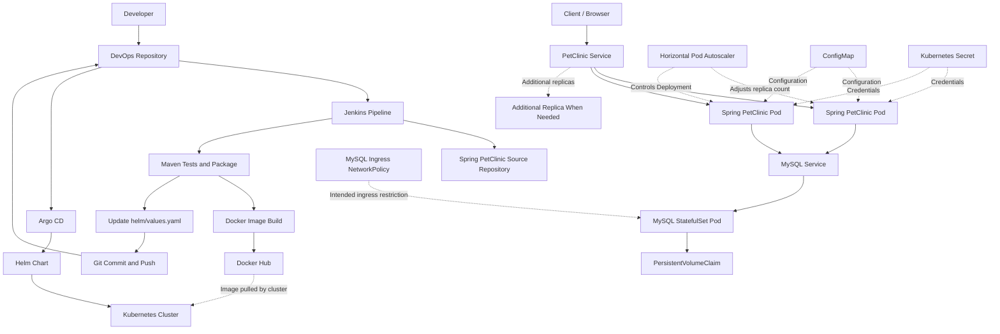

The architecture separates application source code, CI execution, image publishing, and GitOps-based deployment reconciliation.

Jenkins builds and tests the application, builds a Docker image, publishes the image to Docker Hub, and updates the image tag in `helm/values.yaml`.

Argo CD monitors the Git-managed Helm chart and reconciles the Kubernetes resources against the desired state declared in the Argo CD Application.

The Kubernetes Deployment controller performs the actual Pod rollout when the image reference changes. Argo CD initiates the desired-state reconciliation; Kubernetes manages the replacement of application Pods according to the Deployment's rollout strategy.

The HPA manages the application Deployment's replica count within its configured range. The database runs independently using a StatefulSet and persistent storage.

The architecture diagram represents the intended workflow. The actual result of each release must be verified through the Jenkins build, Git commit, Argo CD status, and Kubernetes rollout.

## Technology Stack

| Area | Technology |
|---|---|
| Application | Spring Boot, Java |
| Database | MySQL 8.4 |
| Containerization | Docker |
| CI/CD | Jenkins |
| Container Registry | Docker Hub |
| Source Control | Git, GitHub |
| Orchestration | Kubernetes |
| Local Cluster | Minikube |
| GitOps | Argo CD |
| Kubernetes Packaging | Helm |
| Application Workload | Deployment |
| Database Workload | StatefulSet |
| Networking | Kubernetes Services, NetworkPolicy |
| Configuration | ConfigMap, Helm values |
| Secret Management | Kubernetes Secret |
| Persistent Storage | PersistentVolumeClaim |
| Autoscaling | Horizontal Pod Autoscaler |
| Availability Controls | PodDisruptionBudget |
| Resource Governance | ResourceQuota, LimitRange |

## Repository Structure

```text
spring-petclinic-DevOps/
├── ArgoCD/
│   └── petclinic-application.yaml
├── Docker/
│   └── Dockerfile
├── Jenkins/
│   ├── Jenkinsfile
│   └── Jenkinsfile.before-helm
├── README.md
├── backups/
│   ├── petclinic-20261020-031027.sql
│   └── petclinic-k8s-backup.yaml
├── helm/
│   ├── Chart.yaml
│   ├── values.yaml
│   └── templates/
│       ├── app-configmap.yaml
│       ├── app-deployment.yaml
│       ├── app-hpa.yaml
│       ├── app-pdb.yaml
│       ├── app-service.yaml
│       ├── limit-range.yaml
│       ├── mysql-service.yaml
│       ├── mysql-statefulset.yaml
│       ├── namespace.yaml
│       ├── network-policy.yaml
│       └── resource-quota.yaml
├── k8s/
│   ├── app-configmap.yaml
│   ├── app-deployment.yaml
│   ├── app-hpa.yaml
│   ├── app-pdb.yaml
│   ├── app-service.yaml
│   ├── limit-range.yaml
│   ├── mysql-service.yaml
│   ├── mysql-statefulset.yaml
│   ├── namespace.yaml
│   ├── network-policy.yaml
│   └── resource-quota.yaml
├── screenshots/
│   ├── 1st-pipeline-buid-test-and-build-docker-image.png
│   ├── 1st-pipeline-stages.png
│   ├── ArgoCD-detect-changes-in-variables-outofsync.png
│   ├── ArgoCD-healthy-synced.png
│   ├── ArgoCD-synced-to helm-and-doing-rollout-updates .png
│   ├── ArgoCD-synced-to-helm-chat-repo-before-changing-values.png
│   ├── app-synced-after-new-build.png
│   ├── auto-scaling-hpa-watch.png
│   ├── auto-scaling-pods-watch.png
│   ├── jenkins-commit-in-variables-file.png
│   ├── jenkins-commit-updated-manifest.png
│   ├── pileline-stages-success-update-manifast.png
│   ├── pipeline-stages-changing-imgae-tag-in-hem-variables.png
│   ├── pipeline-stages-push-docker-image.png
│   ├── rollback.png
│   ├── rollout.png
│   ├── scaledown.png
│   ├── self-healing-watch.png
│   └── troubleshooting/
├── tests/
│   └── hpa-load-generator.yaml
└── troubleshooting/
    ├── README.md
    └── screenshots/
```

**GitOps source of truth:** The current Argo CD Application tracks the `helm/` directory. The `k8s/` directory contains standalone Kubernetes manifests and remains useful for inspecting individual resources and for the documented manual deployment workflow. Jenkins updates `helm/values.yaml`, not `k8s/app-deployment.yaml`.

**Security note:** Review both files in `backups/` before publishing or sharing the repository. A SQL dump can contain application data, and a Kubernetes backup can contain sensitive configuration or credentials. Do not commit sensitive backups to a public repository.

## CI/CD Pipeline

The Jenkins pipeline is defined in [`Jenkins/Jenkinsfile`](Jenkins/Jenkinsfile).

The pipeline automates the build and image-delivery workflow and includes a GitOps values-update stage.

### Pipeline Workflow

1. **Checkout DevOps Repository** — checks out the repository containing the pipeline, Dockerfile, Helm chart, and Kubernetes manifests.
2. **Checkout Application** — clones the Spring PetClinic application source.
3. **Test and Package** — runs Maven verification and packaging using the Maven wrapper.
4. **Prepare Docker Context** — prepares the packaged application artifact and Docker build context.
5. **Build Docker Image** — builds the application image and applies versioned and `latest` tags.
6. **Push Docker Image** — authenticates to Docker Hub using Jenkins Credentials and publishes both tags.
7. **Update Helm Image Tag in Git** — updates the application image tag in `helm/values.yaml`, commits the change, and pushes it to the `main` branch.
8. **Argo CD Reconciliation** — Argo CD detects the changed Helm values and reconciles the desired state with the Kubernetes cluster.
9. **Kubernetes Rollout** — the Kubernetes Deployment controller gradually replaces the old application Pods with Pods using the updated image.

The image-update stage executes after image publishing. If an earlier stage fails, the pipeline does not proceed to the GitOps values update.

### Jenkins Credentials

The pipeline uses separate credentials for Docker Hub and GitHub.

| Credential ID | Purpose |
|---|---|
| `dockerhub-credentials` | Docker Hub image publishing |
| `github` | GitHub authentication for pushing the Helm values update |

The `github` credential is configured in Jenkins as **Username with password**. Its password field must contain a valid GitHub Personal Access Token with repository contents write permission.

Credentials should be stored in Jenkins Credentials, not hardcoded into source files or printed in logs.

The GitHub token must never be committed to the repository. The pipeline uses the credential through Jenkins' credential-binding mechanism and a Git askpass helper for Git authentication.

### Pipeline Execution Model

The pipeline is currently started manually. It does not depend on a GitHub webhook to start a build.

This makes the release sequence explicit: a build is initiated, the application is tested and packaged, the image is published, and the Helm values are updated.

A future enhancement could add an automated source-control trigger with appropriate filtering to avoid unnecessary builds.

### Pipeline Validation

The latest successful pipeline execution was captured in the repository screenshots. The recorded workflow includes the Maven build, Docker image publishing, and the GitOps values-update stage.

The successful GitOps update was followed by Argo CD detecting the changed values and reconciling the application.

These screenshots document the observed execution. They should not be interpreted as proof that every future build will succeed or that the application has been tested under production traffic.

## Automated GitOps Image Updates

The GitOps image-update stage connects CI image delivery with Argo CD deployment reconciliation.

### End-to-End Release Flow

```text
Manual Jenkins Build
        |
        v
Checkout DevOps Repository
        |
        v
Checkout Application Source
        |
        v
Maven Verify and Package
        |
        v
Build Docker Image
        |
        v
Push Versioned Image to Docker Hub
        |
        v
Update helm/values.yaml
        |
        v
Commit and Push to GitHub (main)
        |
        v
Argo CD Detects Git Change
        |
        v
Argo CD Reconciles Helm Chart
        |
        v
Kubernetes Deployment Rolling Update
        |
        v
Verify Running Application Pods
```

Jenkins does not directly deploy the application using `kubectl` as part of this workflow. Instead, it updates the desired image reference in Git. Argo CD then reconciles the Kubernetes resources against that desired state.

### Image Tagging Strategy

The pipeline uses the Jenkins build number as the versioned Docker image tag.

The image reference follows this format:

```text
moamenothman1/spring-petclinic:<BUILD_NUMBER>
```

For example, a hypothetical build numbered `12` would publish:

```text
moamenothman1/spring-petclinic:12
```

The pipeline also publishes the `latest` tag, but the Helm values are updated to reference the versioned tag.

This allows the requested image version to be tracked in Git and makes releases easier to identify.

The example build number is illustrative. The actual deployed tag must be checked in the current Helm values and cluster.

### Helm Values Update

The pipeline updates [`helm/values.yaml`](helm/values.yaml).

The relevant configuration follows this structure:

```yaml
app:
  image:
    repository: moamenothman1/spring-petclinic
    tag: "<BUILD_NUMBER>"
```

The tag shown above is a placeholder, not a claim about the current deployed version. The real value is maintained by the pipeline and should be checked in the current repository.

The pipeline modifies the image tag while preserving the rest of the chart configuration, including replica settings, resources, probes, service configuration, and other application settings.

After the update, Jenkins creates a commit describing the new image tag and pushes it to `main`.

### Argo CD Reconciliation

The Argo CD Application tracks the `main` branch and the `helm/` directory.

Automated synchronization allows eligible changes in the Git-managed Helm chart to be applied to Kubernetes without requiring a separate manual deployment command for each release.

Reconciliation is asynchronous. A successful Jenkins build or Git push does not by itself prove that the new image is running. The Argo CD Application and Kubernetes Deployment must also be checked.

### GitOps Verification Commands

Inspect the image reference committed to the remote branch:

```bash
git fetch origin
git show origin/main:helm/values.yaml
```

Check the Argo CD Application:

```bash
kubectl get application petclinic -n argocd
```

Inspect the Deployment rollout:

```bash
kubectl rollout status deployment/spring-petclinic -n petclinic
```

Check the image configured on the Deployment:

```bash
kubectl get deployment spring-petclinic -n petclinic \
  -o jsonpath='{.spec.template.spec.containers[?(@.name=="spring-petclinic")].image}'

echo
```

Inspect the images and readiness of the running application Pods:

```bash
kubectl get pods -n petclinic \
  -o custom-columns='POD:.metadata.name,IMAGE:.spec.containers[*].image,READY:.status.containerStatuses[*].ready'
```

A complete release validation should confirm the expected image tag in Git, successful synchronization and application health in Argo CD, and running Pods using the expected image.

## Docker

The application image is defined in [`Docker/Dockerfile`](Docker/Dockerfile).

Docker provides a consistent packaging format for running the application across development and deployment environments.

The image repository used by the pipeline is:

```text
moamenothman1/spring-petclinic
```

The pipeline publishes two tags:

- A versioned tag based on the Jenkins build number.
- The mutable `latest` tag.

The Helm values should use the versioned tag to make the requested application release explicit.

The current image tag should always be verified in [`helm/values.yaml`](helm/values.yaml) rather than assumed from an earlier build.

## Kubernetes Deployment

The repository contains two representations of the Kubernetes resources:

- `helm/` contains the Helm chart currently tracked by Argo CD.
- `k8s/` contains standalone Kubernetes manifests for individual resources and the documented manual deployment procedure.

The following resource descriptions apply to the corresponding chart templates and standalone manifests. The Helm chart is the source used by the current automated GitOps release workflow.

### Namespace

The namespace is defined in the chart's `namespace.yaml` template and in [`k8s/namespace.yaml`](k8s/namespace.yaml).

Current namespace:

```text
petclinic
```

### Application Deployment

The application Deployment is defined in `helm/templates/app-deployment.yaml` and [`k8s/app-deployment.yaml`](k8s/app-deployment.yaml).

The current workload configuration includes:

- Two initial application replicas, managed by the HPA.
- Container port `8080`.
- CPU and memory requests and limits.
- Startup, readiness, and liveness probes.
- Environment configuration from a ConfigMap.
- Database credentials from a Kubernetes Secret.
- A versioned Docker image reference maintained through the GitOps release workflow.

The Deployment controller maintains the desired number of replicas and supports controlled rollouts when the image or Pod template changes.

### Application Service

The application Service is defined in `helm/templates/app-service.yaml` and [`k8s/app-service.yaml`](k8s/app-service.yaml).

The configured Service uses port `8080` and NodePort `30080`, enabling access through the configured Kubernetes node networking.

Actual reachability depends on the cluster and host networking configuration.

### Database Service

The database Service is defined in `helm/templates/mysql-service.yaml` and [`k8s/mysql-service.yaml`](k8s/mysql-service.yaml).

The database connection uses the Kubernetes DNS name `mysql` on TCP port `3306`.

### MySQL StatefulSet

The MySQL StatefulSet is defined in `helm/templates/mysql-statefulset.yaml` and [`k8s/mysql-statefulset.yaml`](k8s/mysql-statefulset.yaml).

A StatefulSet is appropriate for workloads that need stable identity and persistent storage configuration.

## Application Configuration

Application configuration is defined in `helm/templates/app-configmap.yaml` and [`k8s/app-configmap.yaml`](k8s/app-configmap.yaml).

The current configuration uses the `mysql` Spring profile and a JDBC URL following this format:

```text
jdbc:mysql://mysql:3306/petclinic
```

The database name, Service name, port, and active Spring profile must remain consistent with the database and application configuration.

The ConfigMap keeps non-sensitive settings outside the application image, making it possible to adjust deployment configuration independently of the build process.

## Database and Persistent Storage

MySQL uses a PersistentVolumeClaim associated with the StatefulSet.

The observed database claim has the following configuration:

| Property | Value |
|---|---|
| Claim | `mysql-data-mysql-0` |
| Requested capacity | `2Gi` |
| Access mode | `ReadWriteOnce` |
| Observed status | `Bound` |

Persistent storage helps retain database files when the database Pod is recreated. Actual data retention also depends on the storage provisioner and the PersistentVolume reclaim policy.

Persistent volumes are not a replacement for tested database backups. A recovery plan should include backup creation, retention, and restoration testing.

**Important:** Avoid deleting the MySQL PVC or StatefulSet as a routine troubleshooting step. Verify the storage configuration and back up any data that must be retained before performing destructive operations.

## Secrets Management

The application uses a Kubernetes Secret named `mysql-secret` in the `petclinic` namespace to provide database credentials to the application and MySQL workload.

The Secret contains the keys expected by the current manifests:

- `username`
- `password`
- `root-password`

The Secret currently exists directly in the Kubernetes cluster. A corresponding Secret manifest is intentionally not stored in the repository.

### Current Approach

- The application consumes credentials through Kubernetes `secretKeyRef` references.
- Secret values are kept separate from version-controlled application manifests.
- The Secret is provisioned and maintained separately from the Git-managed Kubernetes resources.
- The `k8s/mysql-secret.yaml` manifest is not present in the repository.
- The previously deleted SealedSecret manifest is no longer part of the current Git-managed configuration.

This means the current cluster depends on the separately provisioned Secret being present. Cloning the repository and applying the manifests alone will not recreate the database credentials.

### Production Considerations

For a reproducible production deployment, a dedicated secrets-management approach should be established. Possible approaches include External Secrets Operator backed by a secrets manager, or Sealed Secrets configured and validated for the target cluster.

Sensitive credentials must not be committed to Git as plaintext. Base64 encoding is not encryption, and a private repository should not be treated as a secrets manager.

The secret-management solution should define credential rotation, access controls, recovery procedures, and how secrets are provisioned when a new environment is created.

## Security

### NetworkPolicy

The MySQL ingress policy is defined in `helm/templates/network-policy.yaml` and [`k8s/network-policy.yaml`](k8s/network-policy.yaml).

The policy selects Pods labelled `app=mysql` and permits inbound TCP traffic on port `3306` from Pods labelled `app=spring-petclinic`.

The policy does not define application ingress or egress restrictions.

Effective enforcement depends on the cluster's CNI implementation. The existence of a NetworkPolicy resource alone does not guarantee that traffic is filtered; the cluster networking configuration must support enforcement.

### Credential and Backup Handling

- Store registry credentials in Jenkins Credentials.
- Keep database credentials outside source-controlled manifests.
- Do not commit plaintext credentials or secret-bearing backup files.
- Review database dumps and Kubernetes backups before publishing them.
- Restrict access to Kubernetes Secrets using appropriate RBAC permissions.
- Protect backups of cluster configuration and secret-management keys.
- Use a dedicated secrets-management solution for production deployments.
- Never put a GitHub Personal Access Token or Docker Hub token directly into the Jenkinsfile.

## Reliability and Resource Management

### Health Probes

The application Deployment defines startup, readiness, and liveness probes.

- **Startup probe:** Allows the application time to start.
- **Readiness probe:** Controls whether the Pod is considered ready to receive traffic.
- **Liveness probe:** Helps detect a container that is no longer functioning correctly.

These probes help Kubernetes manage application availability and container recovery, but they do not guarantee that every application failure will be detected.

### Self-Healing

The Deployment controller maintains the desired number of application replicas and replaces Pods when necessary.

Evidence from the implementation is available in [`screenshots/self-healing-watch.png`](screenshots/self-healing-watch.png).

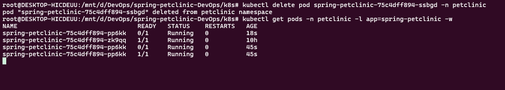

This demonstrates the captured self-healing scenario; it does not by itself prove resilience to every node or infrastructure failure.

### PodDisruptionBudget

The PodDisruptionBudget is defined in `helm/templates/app-pdb.yaml` and [`k8s/app-pdb.yaml`](k8s/app-pdb.yaml).

The configuration includes:

```yaml
spec:
  minAvailable: 1
```

The PDB helps limit certain voluntary disruptions from reducing the number of available application Pods below the configured threshold.

It does not prevent every disruption and does not guarantee availability during unexpected node failures.

### ResourceQuota

The namespace ResourceQuota is defined in `helm/templates/resource-quota.yaml` and [`k8s/resource-quota.yaml`](k8s/resource-quota.yaml).

The configuration defines namespace-level limits for:

- Aggregate CPU requests and limits.
- Aggregate memory requests and limits.
- Number of Pods.
- Number of Services.
- Number of PersistentVolumeClaims.
- Total requested persistent storage.

The updated quota was validated using a Kubernetes server-side dry run and then applied successfully.

The quota must be sized to accommodate the configured application replicas, database workload, and other Pods in the namespace.

### LimitRange

The LimitRange is defined in `helm/templates/limit-range.yaml` and [`k8s/limit-range.yaml`](k8s/limit-range.yaml).

It defines minimum and maximum container resources along with default requests and limits.

These defaults apply to new containers that omit explicit resource settings. They do not replace resource values already specified in a Pod or Deployment manifest.

## Horizontal Pod Autoscaling

The Horizontal Pod Autoscaler is defined in `helm/templates/app-hpa.yaml` and [`k8s/app-hpa.yaml`](k8s/app-hpa.yaml).

### Configuration

| Setting | Value |
|---|---|
| Target Deployment | `spring-petclinic` |
| Metric | CPU utilization |
| Target utilization | 70% of requested CPU |
| Minimum replicas | 2 |
| Maximum replicas | 4 |

The HPA uses CPU metrics to adjust the Deployment's replica count. It depends on a working metrics pipeline and sufficient namespace quota and cluster capacity.

### Load Test

A temporary load-generator Pod defined in [`tests/hpa-load-generator.yaml`](tests/hpa-load-generator.yaml) sent repeated HTTP requests to the application Service.

The HPA watch captured the following progression:

| Observed CPU utilization | Replica count | Observation |
|---:|---:|---|
| 2% | 2 | Baseline before load |
| 94% | 2 → 3 | Scale-up began |
| 150% | 3 → 4 | Further scale-up |
| 84%–100% | 4 | Maximum replica count reached |

After the load generator was stopped, the application scaled down again.

**Verified outcome:** The local Minikube environment successfully scaled the application from two replicas to four under generated HTTP load and subsequently scaled down after the load was removed.

The CPU utilization values are measured relative to the containers' CPU requests, not the total CPU utilization of the host machine.

This test demonstrates HPA behavior under the specific local workload. It is not a production performance benchmark and does not establish maximum throughput, latency, or user capacity.

### Autoscaling Evidence

**HPA metrics and replica changes**

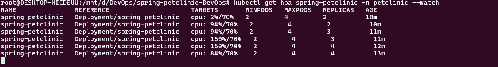

**Pod count during autoscaling**

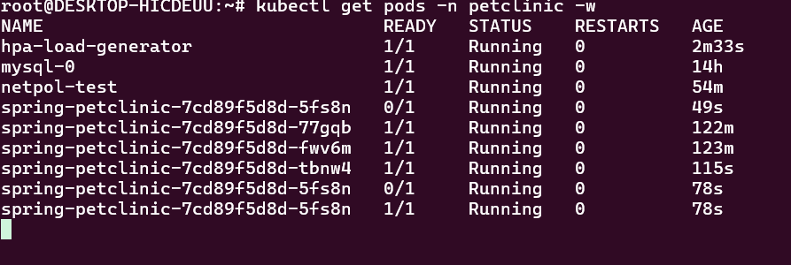

**Scale-down after load removal**

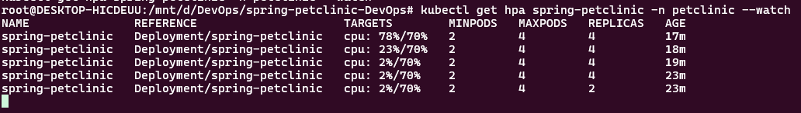

## Argo CD and GitOps

Argo CD manages the desired state of the PetClinic Kubernetes resources from Git.

The Argo CD Application manifest is stored in [`ArgoCD/petclinic-application.yaml`](ArgoCD/petclinic-application.yaml).

### Application Configuration

The Application points to the GitHub repository and uses the `helm/` directory as its source path.

| Setting | Configuration |
|---|---|
| Application name | `petclinic` |
| Argo CD namespace | `argocd` |
| Git branch | `main` |
| Manifest path | `helm/` |
| Destination namespace | `petclinic` |
| Automated sync | Enabled |
| Self-healing | Enabled |
| Pruning | Enabled |

The Application uses automated synchronization with `selfHeal: true` and `prune: true`.

### Automated Synchronization

Automated synchronization allows Argo CD to apply eligible changes from the Git-managed desired state without requiring a manual sync for each change.

The self-healing configuration allows Argo CD to reconcile supported live-resource changes that differ from the desired state in Git.

The default reconciliation interval can vary with Argo CD configuration. A webhook can also be configured to notify Argo CD of repository changes.

### Observed Helm Values Update and Rollout

During the successful release documented in the screenshots, Jenkins updated the image tag in `helm/values.yaml` and pushed the change to GitHub.

Argo CD then detected that the desired state in Git differed from the currently applied state and displayed the Application as `OutOfSync`.

After reconciliation, Argo CD synchronized the Helm chart. During the rollout, a new application Pod appeared while an existing Pod was still running. The Deployment controller gradually replaced the old Pods as the new version became ready.

This behavior is the expected distinction between GitOps reconciliation and a Kubernetes rolling update:

- **Jenkins** builds and publishes the image, then updates the image tag in Git.
- **Argo CD** detects the Git change and reconciles the desired state.
- **Kubernetes Deployment** performs the rolling update and manages the replacement of Pods.
- **Readiness probes** help determine whether new Pods are ready to receive traffic.

Argo CD does not itself implement the Pod-by-Pod rolling update. It applies the desired configuration, and Kubernetes controllers carry out the rollout.

### Pruning and Resource Lifecycle

With `prune: true`, Argo CD can delete resources it manages when their manifests are removed from the tracked Git source.

This behavior was relevant during the SealedSecret troubleshooting process: after the SealedSecret manifest was removed from Git and pruning was enabled, the old SealedSecret resource was removed from the cluster, while the separately existing ordinary Kubernetes Secret remained available.

This outcome was verified in the current cluster. It should not be interpreted as a guarantee that pruning will always preserve a same-named Secret; resource ownership and controller behavior matter.

Pruning is a potentially destructive operation. Changes to tracked manifests should be reviewed carefully, particularly for persistent data, credentials, and resources that are not intended to be deleted automatically.

### Secrets and GitOps Scope

The current Argo CD Application tracks the `helm/` directory. The ordinary `mysql-secret` is not defined by a manifest in the tracked Helm chart and is maintained separately from Argo CD's Git-managed resources.

Consequently, Argo CD does not provide complete lifecycle management for that Secret. A fresh environment requires a separate, secure process to provision the database credentials before the workloads that depend on them can operate successfully.

### Verification Evidence

**Argo CD detects the changed Helm values**

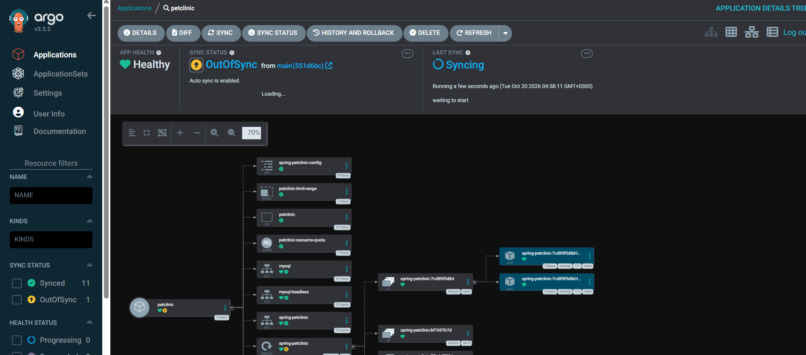

**Argo CD synchronization and rollout**


**Argo CD Application — Synced and Healthy**

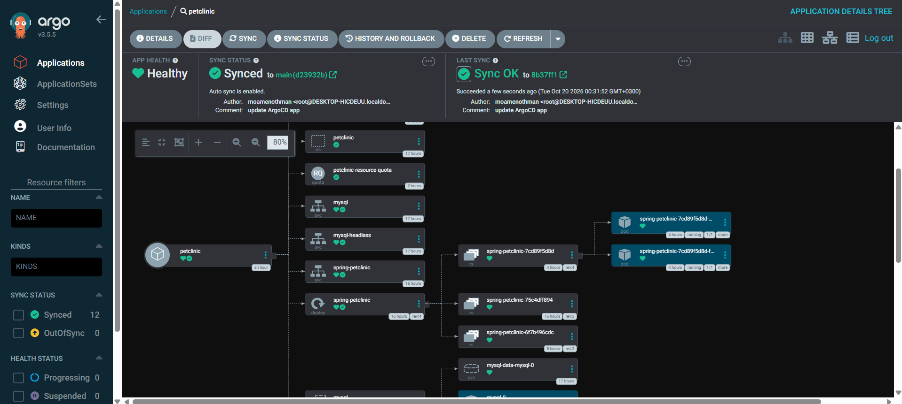

These screenshots record the Application state at the time they were captured. Current synchronization and health should be checked in the cluster when reproducing the project.

## Pipeline Evidence

The `screenshots/` directory contains evidence of pipeline execution, image publishing, GitOps values updates, Argo CD reconciliation, and Kubernetes operations.

### Build and Image Delivery

**Initial pipeline build, tests, and Docker image creation**

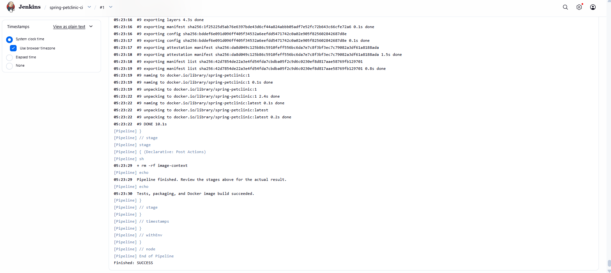

**Initial pipeline stages**

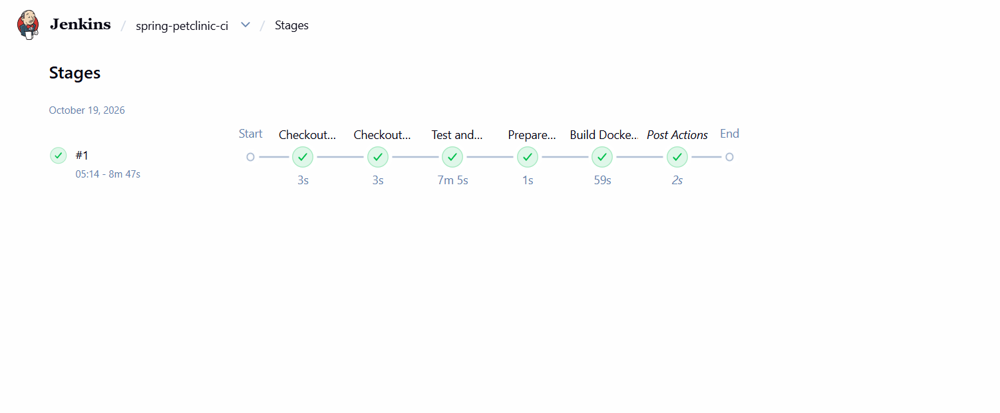

**Pipeline stages and Docker image publishing**

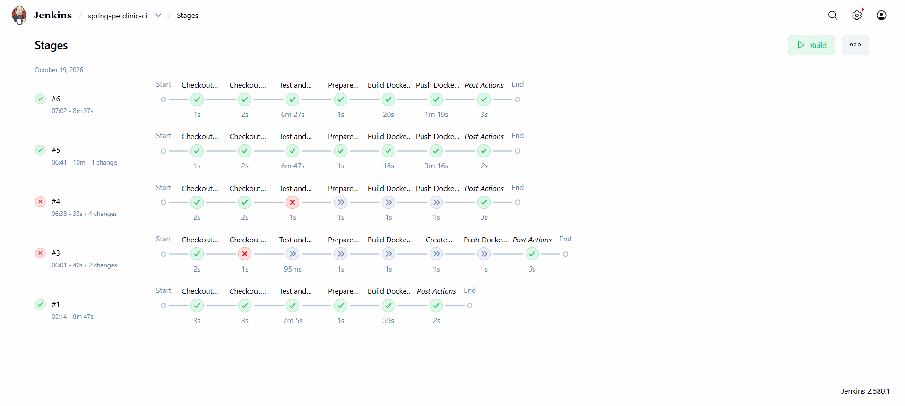

### GitOps Values Update

**Pipeline stages changing the image tag in Helm values**

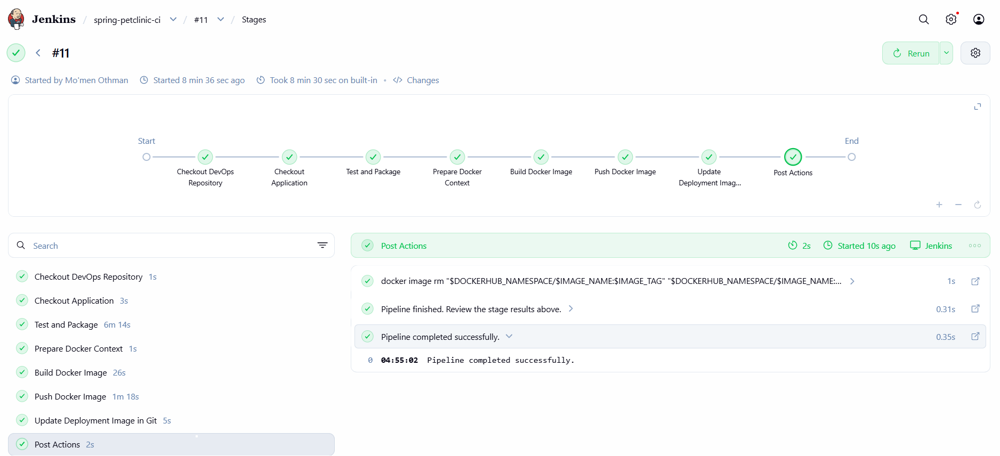

**Jenkins commit updating the Helm values**

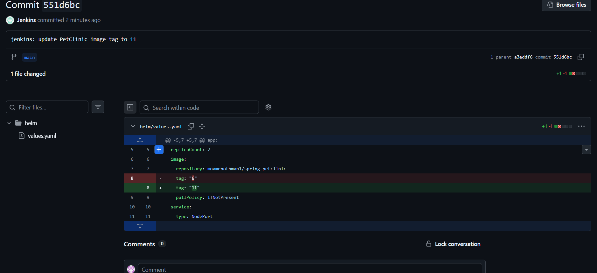

**Pipeline stages completing the GitOps update**

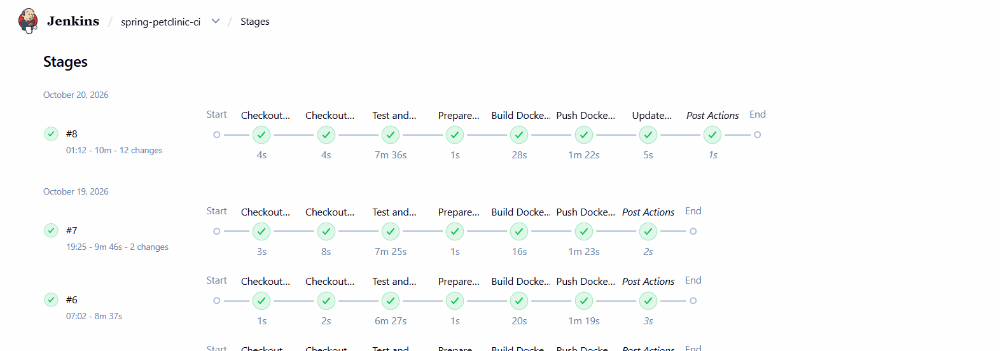

**GitHub commit showing the updated configuration**

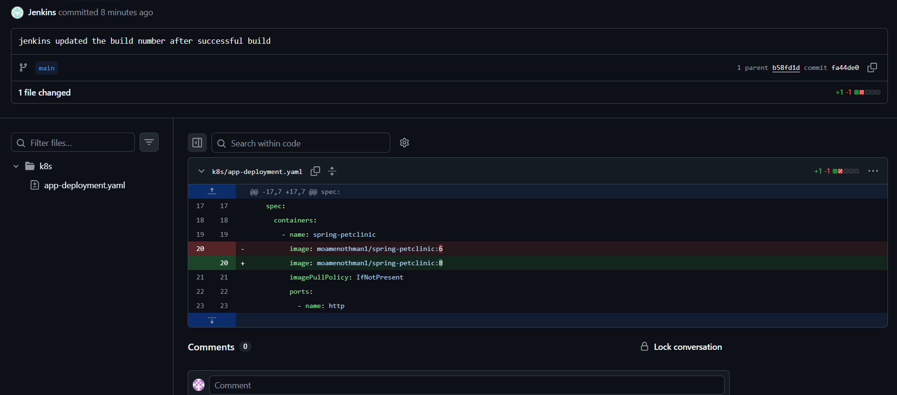

### Argo CD Reconciliation

**Argo CD detects the new desired state**


**Argo CD synchronized after the new build**

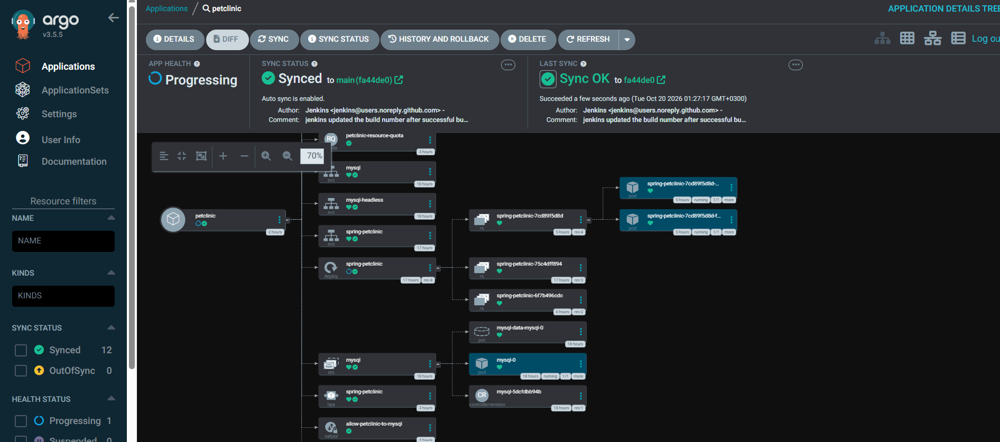

**Argo CD reaches the Healthy and Synced state**


The screenshots document the observed GitOps workflow. For a release to be considered validated, the commit, Argo CD state, and running Kubernetes image should agree on the expected version.

### Kubernetes Operations

**Deployment rollout**

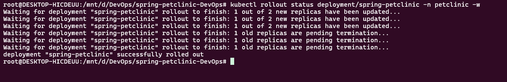

**Rolling update during Argo CD reconciliation**


**Rollback demonstration**

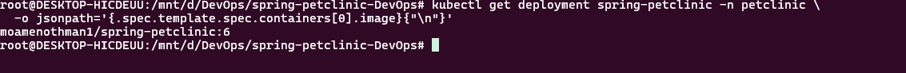

**Self-healing demonstration**


These screenshots provide supporting evidence of the activities captured during the project. Current workload status should be checked directly in the target cluster.

## Deployment and Verification

This section describes the standalone Kubernetes manifest workflow using `k8s/`. It is separate from the automated GitOps release path, which uses the Helm chart in `helm/`.

When using Argo CD, changes to the tracked Helm chart should be committed to Git and reconciled by Argo CD rather than applying conflicting standalone manifests over the same resources.

### Prerequisites

Install and configure:

- Docker
- `kubectl`
- Minikube or another Kubernetes cluster
- Git
- Jenkins and the required build tools, if running the pipeline
- Helm, if working with the chart locally
- Argo CD, if using GitOps synchronization

Ensure the cluster has sufficient resources and a working StorageClass for the MySQL persistent volume.

The database credentials must be provisioned separately because the repository does not currently include a Secret manifest.

### 1. Clone the Repository

```bash
git clone https://github.com/moamenothman/spring-petclinic-DevOps.git
cd spring-petclinic-DevOps
```

### 2. Check the Kubernetes Context

```bash
kubectl config current-context
kubectl get nodes
```

Confirm that the commands target the intended development cluster.

### 3. Create the Namespace

```bash
kubectl apply -f k8s/namespace.yaml
```

### 4. Apply Application Configuration

```bash
kubectl apply -f k8s/app-configmap.yaml
```

### 5. Provision the Database Secret

Before deploying MySQL, provision the `mysql-secret` Secret in the `petclinic` namespace using an approved secure method.

The Secret must contain these keys:

- `username`
- `password`
- `root-password`

Do not attempt to apply `k8s/mysql-secret.yaml`; that file is not present in the current repository.

Do not place actual credentials in shell history, source-controlled files, or public documentation. Use an appropriate secure provisioning process for the target environment.

### 6. Deploy MySQL

```bash
kubectl apply -f k8s/mysql-service.yaml
kubectl apply -f k8s/mysql-statefulset.yaml
```

Wait for the database Pod to become ready before relying on application connectivity.

### 7. Deploy the Application

```bash
kubectl apply -f k8s/app-service.yaml
kubectl apply -f k8s/app-deployment.yaml
```

### 8. Apply Resource and Availability Controls

```bash
kubectl apply -f k8s/resource-quota.yaml
kubectl apply -f k8s/limit-range.yaml
kubectl apply -f k8s/app-pdb.yaml
kubectl apply -f k8s/app-hpa.yaml
```

Ensure the namespace quota permits the intended workload and that Metrics Server is available before relying on HPA decisions.

### 9. Apply the NetworkPolicy

```bash
kubectl apply -f k8s/network-policy.yaml
```

### 10. Verify the Workloads

```bash
kubectl get pods -n petclinic
kubectl get services -n petclinic
kubectl get pvc -n petclinic
kubectl get networkpolicy -n petclinic
kubectl get hpa -n petclinic
kubectl get pdb -n petclinic
kubectl get resourcequota -n petclinic
kubectl get limitrange -n petclinic
kubectl get secret mysql-secret -n petclinic
```

The last command displays Secret metadata, not its stored credential values.

Inspect rollout status and application logs:

```bash
kubectl rollout status deployment/spring-petclinic -n petclinic
kubectl rollout status statefulset/mysql -n petclinic
kubectl logs deployment/spring-petclinic -n petclinic --tail=80
```

To verify NetworkPolicy behavior, test permitted application-to-database traffic and an unauthorized connection attempt. Confirm that the CNI enforces NetworkPolicy rules before treating the restriction as a validated security control.

### 11. Monitor Autoscaling

```bash
kubectl top pods -n petclinic
kubectl describe hpa spring-petclinic -n petclinic
kubectl get hpa spring-petclinic -n petclinic --watch
```

To run the load test:

```bash
kubectl apply -f tests/hpa-load-generator.yaml
```

After the test, stop the load generator:

```bash
kubectl delete -f tests/hpa-load-generator.yaml
```

Monitor the HPA and Deployment to observe scale-down behavior. The test manifest can be retained for future repeatable validation.

### 12. Verify Argo CD

Check the Application's synchronization and health:

```bash
kubectl get application petclinic -n argocd
```

Inspect Application conditions and resource status:

```bash
kubectl describe application petclinic -n argocd
```

The Application should be reviewed for both synchronization status and health status. A synchronized Application is not necessarily healthy, and a healthy workload does not by itself mean that all resources are synchronized with Git.

### 13. Verify the GitOps Release

After a Jenkins build completes, fetch the latest remote state:

```bash
git fetch origin
git show origin/main:helm/values.yaml
```

Check the Deployment image:

```bash
kubectl get deployment spring-petclinic -n petclinic \
  -o jsonpath='{.spec.template.spec.containers[?(@.name=="spring-petclinic")].image}'

echo
```

Check the Pods:

```bash
kubectl get pods -n petclinic \
  -o custom-columns='POD:.metadata.name,IMAGE:.spec.containers[*].image,READY:.status.containerStatuses[*].ready'
```

Confirm that the image tag in Git matches the Deployment and running Pods. Also confirm that the Argo CD Application is synchronized and healthy.

If the values change but Argo CD does not reconcile them, inspect the Application's repository, branch, source path, sync policy, and events before attempting a manual sync.

### Optional: Validate the Helm Chart

You can validate the chart locally before committing changes:

```bash
helm lint ./helm
helm template petclinic ./helm
```

These commands validate chart structure and render the Kubernetes resources locally. They do not deploy the chart or prove that the resulting application is healthy.

## Troubleshooting

Troubleshooting notes and related evidence are maintained in [`troubleshooting/README.md`](troubleshooting/README.md).

The troubleshooting record should capture:

- Symptoms and relevant error messages.
- Root cause, when established.
- Fixes attempted.
- Validation steps and observed results.
- Screenshots or logs supporting the final outcome.

Only verified results should be marked as resolved.

## Future Improvements

Potential future enhancements include:

- Automated builds triggered by source-control changes with safe trigger filtering.
- Explicit release promotion between environments.
- Helm chart validation and automated testing in the CI pipeline.
- A fully reproducible GitOps workflow for multiple environments.
- Secure Secret lifecycle management using External Secrets Operator or correctly configured Sealed Secrets.
- Metrics and dashboards with Prometheus and Grafana.
- Centralized log collection.
- Additional NetworkPolicy rules after mapping required traffic flows.
- Database backup and restore validation.
- Deployment security scanning and image vulnerability assessment.
- Cloud deployment using a managed Kubernetes service.
- A controlled rollback process that updates the Git-managed desired state as well as the running Deployment.
- Automated validation that the deployed image matches the version recorded in Git.
- Automated verification that the application remains healthy after each release.
- Documentation of tested resource requirements and repeatable deployment procedures.

These are potential extensions, not claims that the corresponding features are already implemented.

## Author

**Mo'men Othman**

- GitHub: [moamenothman](https://github.com/moamenothman)
- Project: [spring-petclinic-DevOps](https://github.com/moamenothman/spring-petclinic-DevOps)

